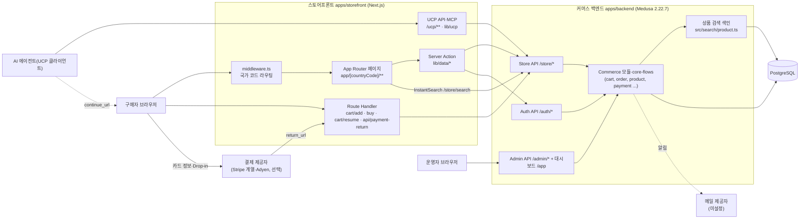

# Medusa DTC Starter AS-IS 설계 분석

## 1. 개요

### 1.1 분석 범위

| 구분 | 대상 | 비고 |
| --- | --- | --- |
| 포함 | `apps/storefront` 구매자 화면 전체(25개 페이지), 서버 측 처리(Server Action·Route Handler·미들웨어), UCP 에이전트 API | 화면 목록은 [screen-layout.md](screen-layout.md#전체-페이지장면-목록) |
| 포함 | `apps/backend`의 Medusa 설정과 프로젝트 고유 코드(상품 검색 색인, `/store/search` 미들웨어, 초기 데이터 마이그레이션, 데모 시드, 예시 API) | Medusa 기본 모듈·워크플로는 공개 계약 수준으로만 다룬다 |
| 제외 | Medusa Admin 대시보드(`/app`) 화면 | `src/admin`에 위젯·라우트가 없고 패키지 기본 UI만 쓴다. 프로젝트 코드가 아니므로 화면 분석에서 뺐다 |
| 제외 | `@medusajs/*` 패키지 내부 구현 | 설치된 패키지 소스가 없다(`node_modules` 미설치). 공개 계약은 SDK 메서드명과 문서 기준으로 추정했다 |
| 제외 | 화면이 없는 경로: `llms.txt`, `robots`, `sitemap`, OG 이미지, 상품 Markdown(`/products/[handle].md`) | 에이전트·크롤러용 출력. 기능 목록에만 기록 |

### 1.2 기준선과 근거

- 기준 커밋: `44f2979`(`chore: update @medusajs/* to v2.22.7`). 분석 시작 시 작업 트리는 깨끗했다. 분석 중에 추가한 파일은 `docs/design/20261114-223310/` 아래뿐이다.
- 버전: Medusa 2.22.7, Next.js App Router(스토어프론트 문구상 Next.js 16), Node 22.
- 근거: 소스 코드를 읽는 정적 분석만 했다. 앱을 실행하거나 백엔드·DB에 접속하지 않았고, 실제 화면을 관찰하지 않았다. 화면 HTML은 코드의 마크업·문구·Tailwind 클래스를 보고 재현했다.
- 같은 날짜 폴더의 [frontend/navigation.md](../frontend/navigation.md)는 앞서 작성한 Navigation 단독 문서다. 이 AS-IS의 [navigation.md](navigation.md)가 화면 링크를 포함한 최신 원본이다.

### 1.3 미확인 범위

| 항목 | 이유 | 필요한 근거 |
| --- | --- | --- |
| SDK 메서드의 실제 HTTP 경로·응답 형태 | `@medusajs/js-sdk`가 설치되지 않아 소스를 읽지 못했다 | 패키지 설치 후 `node_modules/@medusajs/js-sdk` 확인 |
| 결제 제공자 연동 | `medusa-config.ts`에 결제 모듈 설정이 없고 시드 지역은 `pp_system_default`(수동 결제)만 쓴다. 스토어프론트에는 Stripe 계열·Adyen 처리 코드가 있다 | 운영 환경의 백엔드 모듈 설정(예: Medusa Cloud) |
| 이메일 인증·주문 이전 메일 발송 | 알림(Notification) 제공자 설정이 없다. 메일 본문의 링크 주소를 만드는 위치를 찾지 못했다 | 백엔드 알림 모듈·구독자 설정 |
| Redis 사용 | `.env.template`에 `REDIS_URL`이 있지만 `medusa-config.ts`가 캐시·이벤트 모듈을 등록하지 않는다 | 배포 환경 설정 |
| 실제 화면 모양·반응형 동작 | 앱을 실행하지 않았다 | 로컬 실행 후 브라우저 관찰 |

## 2. 시스템 구조

- **스토어프론트**는 Next.js 서버다. 페이지는 서버 컴포넌트에서 `lib/data/*`로 백엔드를 호출하고, 쓰기 작업은 Server Action(`"use server"`)으로 처리한다. 장바구니 ID·인증 토큰은 HTTP-only 쿠키(`_medusa_cart_id`, `_medusa_jwt`)에 둔다.
- 모든 백엔드 호출은 `@medusajs/js-sdk` 클라이언트(`lib/config.ts`)를 거치며 publishable key와 `x-medusa-locale` 헤더를 붙인다. 미들웨어만 Edge 런타임이라 `fetch`로 `/store/regions`를 직접 부른다.
- **JavaScript 없이도 쓰는 경로**가 있다. 상품 담기 폼은 `POST /{cc}/cart/add`, 검색 폼은 `GET /{cc}/search`로 동작한다.
- **UCP**(Universal Commerce Protocol) API는 AI 에이전트가 카탈로그 조회·장바구니·체크아웃 세션을 만들게 한다. 결제는 API로 받지 않고 `continue_url`(`/{cc}/cart/resume/{cartId}`)로 구매자에게 넘긴다.
- **커머스 백엔드**는 Medusa 기본 모듈·API를 거의 그대로 쓴다. 프로젝트 고유 코드는 상품 검색 색인 정의, `/store/search` 범위 미들웨어, 지역 정책 메타데이터 시드, 예시 라우트(`/store/custom`, `/admin/custom`)뿐이다.
- 결제 제공자와 메일 제공자는 설정에 따라 붙는 외부 시스템이다. 기본 설정에서는 수동 결제만 동작한다.

## 3. 핵심 용어

| 용어 | 의미 | 코드 위치 |
| --- | --- | --- |
| 국가 코드(`countryCode`, `cc`) | URL 첫 세그먼트. 백엔드 지역(Region)의 국가 ISO-2 코드 | `middleware.ts`, `app/[countryCode]` |
| 지역(Region) | 통화·국가·결제 제공자를 묶는 Medusa 단위. 시드는 Europe(EUR, gb/de/dk/se/fr/es/it) 하나 | `initial-data-seed.ts` |
| 지역 정책 | 지역 `metadata`에 둔 반품 기간·무료 반품·배송비·처리/배송 일수 | `backend/src/lib/region-store-policies.ts`, `storefront/lib/data/store-policies.ts` |
| 장바구니(Cart) | 구매 전 품목·주소·배송·결제 세션을 담는 객체. 완료하면 주문(Order)이 된다 | `lib/data/cart.ts` |
| 체크아웃 단계(`step`) | `address` → `delivery` → `payment` → `review`. 같은 페이지의 쿼리로 전환 | `modules/checkout/**` |
| 결제 세션(Payment Session) | 장바구니의 결제 수단별 세션. Stripe 계열은 카드 입력, Adyen은 Drop-in, 수동 결제는 바로 주문 | `lib/data/cart.ts` `initiatePaymentSession`, `lib/constants.tsx` |
| 결제 복귀(`payment-return`) | 외부 결제창·은행 인증 후 돌아오는 Route Handler | `app/api/payment-return/route.ts` |
| publishable key | Store API 호출에 필요한 공개 키. 판매 채널 범위를 정한다 | `NEXT_PUBLIC_MEDUSA_PUBLISHABLE_KEY` |
| 대기 고객 정보(`_medusa_pending_customer`) | 회원가입 입력값을 이메일 인증 후 첫 로그인까지 보관하는 쿠키 | `lib/data/customer.ts` |
| 장바구니 이전(transfer cart) | 로그인 후 익명 장바구니를 고객에게 연결하는 처리 | `transferCart` |
| 주문 소유권 이전(order transfer) | 게스트 주문을 계정으로 옮기는 요청·수락·거절 | `lib/data/orders.ts` |
| UCP | AI 에이전트용 커머스 프로토콜. `/.well-known/ucp`로 기능을 알리고 REST·MCP로 호출 | `app/ucp/**`, `lib/ucp/**` |
| 퍼머링크(`/buy`) | `/buy/{variant}:{qty},...`로 장바구니를 만들고 체크아웃을 여는 링크 | `app/buy/[items]/route.ts` |
| 상품 검색 색인 | 상품·가격·옵션·카테고리를 검색 문서로 만들어 InstantSearch에 제공 | `backend/src/search/product.ts`, `storefront/lib/search-client.ts` |

## 4. 서비스 목록

| 서비스(한글명) | 구현 이름 | 책임 | 상태 소유 | Job Flow |
| --- | --- | --- | --- | --- |
| 스토어프론트 | `apps/storefront` (`@dtc/storefront`) | 화면 렌더링, 국가 라우팅, 쿠키 세션, 결제 위젯·복귀 처리, UCP 변환 | 쿠키(장바구니 ID·토큰·대기 고객·캐시 ID). 업무 데이터는 소유하지 않는다 | [storefront.md](details/job-flow/storefront.md) |
| 커머스 백엔드 | `apps/backend` (`@dtc/backend`) | 상품·가격·장바구니·주문·고객·인증·결제 세션·검색 색인 | PostgreSQL의 모든 커머스 데이터 | [backend.md](details/job-flow/backend.md) |

두 서비스의 협력은 [system.md](details/job-flow/system.md), 시스템과 외부의 관계는 [macro.md](details/job-flow/macro.md)에 있다.

## 5. 기능 목록

| ID | 기능 | 실제 진입점 | 관련 문서 |
| --- | --- | --- | --- |
| F01 | 국가 코드 라우팅·국가 변경 | `middleware.ts`, 사이드 메뉴 `CountrySelect` → `updateRegion` | [N01](navigation.md#n01) |
| F02 | 홈·컬렉션 레일 | `/{cc}` | [N02](navigation.md#n02) |
| F03 | 전체 상품 목록·필터·검색(InstantSearch) | `/{cc}/store`, `POST /store/search` | [N02](navigation.md#n02), [N03](navigation.md#n03) |
| F04 | 카테고리·컬렉션 목록 | `/{cc}/categories/[...]`, `/{cc}/collections/[handle]` | [N02](navigation.md#n02) |
| F05 | 헤더 검색 드로어·검색 페이지 | 헤더 검색 아이콘, `/{cc}/search?q=` | [N03](navigation.md#n03) |
| F06 | 상품 상세·옵션 선택 | `/{cc}/products/[handle]` | [N04](navigation.md#n04) |
| F07 | 장바구니 담기(JS·폼) | `addToCart` Server Action, `POST /{cc}/cart/add` | [N04](navigation.md#n04) |
| F08 | 장바구니 수량 변경·삭제·할인 코드 | `/{cc}/cart`, `updateLineItem`, `deleteLineItem`, `applyPromotions` | [N05](navigation.md#n05) |
| F09 | 체크아웃 주소·배송·결제 단계 | `/{cc}/checkout?step=` | [N06](navigation.md#n06) |
| F10 | 주문하기(수동·Stripe 계열·Adyen) | 검토 단계 Place order, `placeOrder` | [N07](navigation.md#n07) |
| F11 | 외부 결제 복귀 | `GET /api/payment-return` | [N08](navigation.md#n08) |
| F12 | 주문 완료 화면 | `/{cc}/order/[id]/confirmed` | [N07](navigation.md#n07) |
| F13 | 로그인·회원가입 | `/{cc}/account`(비로그인) | [N09](navigation.md#n09) |
| F14 | 이메일 인증 | `/{cc}/verify-account?token=` | [N10](navigation.md#n10) |
| F15 | 계정 개요·로그아웃 | `/{cc}/account`(로그인) | [N11](navigation.md#n11) |
| F16 | 프로필 수정 | `/{cc}/account/profile` | [N12](navigation.md#n12) |
| F17 | 배송지 관리 | `/{cc}/account/addresses` | [N13](navigation.md#n13) |
| F18 | 주문 목록·상세 | `/{cc}/account/orders`, `/orders/details/[id]` | [N14](navigation.md#n14) |
| F19 | 주문 소유권 이전 요청 | `Orders` 하단 폼 | [N15](navigation.md#n15) |
| F20 | 주문 소유권 이전 수락·거절 | `/{cc}/order/[id]/transfer/[token]`, `/accept`, `/decline` | [N16](navigation.md#n16) |
| F21 | 정책·안내 페이지 | `/{cc}/shipping`, `returns`, `terms`, `privacy`, `contact` | [N17](navigation.md#n17) |
| F22 | 퍼머링크·에이전트 장바구니 이어받기 | `GET /buy/[items]`, `GET /{cc}/cart/resume/[cartId]` | [N18](navigation.md#n18) |
| F23 | 없는 페이지 | `not-found.tsx` 3곳 | [N19](navigation.md#n19) |
| F24 | UCP 카탈로그·장바구니·체크아웃 API | `/ucp/v1/**`, `/ucp/mcp`, `/.well-known/ucp` | UI 없음. [macro.md](details/job-flow/macro.md#m04-ai-에이전트의-장바구니-위임), [storefront.md](details/job-flow/storefront.md#s06-ucp-체크아웃-세션) |
| F25 | 에이전트·검색엔진용 출력 | `llms.txt`, `robots.ts`, `sitemap.ts`, 상품 Markdown, JSON-LD | UI 없음. 기능 목록에만 기록 |
| F26 | 상품 검색 색인 갱신 | 상품·변형·가격 이벤트 구독(`PRODUCT_EVENTS`) | [backend.md](details/job-flow/backend.md#b03-상품-검색-색인-갱신) |
| F27 | 초기 데이터·데모 상품 시드 | `db:migrate`의 migration-scripts, `seed-demo-products.ts` | [backend.md](details/job-flow/backend.md#b04-초기-데이터-시드) |
| F28 | 운영자 관리(상품·주문·지역 등) | Medusa Admin `/app` | 화면 제외. [macro.md](details/job-flow/macro.md) 외부 객체로만 표시 |

## 6. 산출물

| 문서 | 내용 |
| --- | --- |
| [navigation.md](navigation.md) | 시나리오 19개의 화면 이동과 화면 확인 링크 |
| [screen-layout.md](screen-layout.md) | 전체 페이지 25개·장면 목록과 페이지별 Layout |
| [details/screens/](details/screens/) | 페이지별 HTML 25개와 공통 자산(`assets/store.css`, `assets/shell.js`) |
| [details/job-flow/macro.md](details/job-flow/macro.md) | 시스템과 구매자·운영자·AI 에이전트·결제 제공자의 관계 |
| [details/job-flow/system.md](details/job-flow/system.md) | 스토어프론트와 커머스 백엔드의 협력 |
| [details/job-flow/storefront.md](details/job-flow/storefront.md) | 스토어프론트 내부 흐름 |
| [details/job-flow/backend.md](details/job-flow/backend.md) | 커머스 백엔드의 프로젝트 고유 흐름 |

## 7. 관찰 이슈

| ID | 내용 | 근거 | 영향 |
| --- | --- | --- | --- |
| I01 | 결제·주문 실패 복귀 시 `Cart?error=payment_failed\|order_failed`로 보내지만 장바구니 페이지가 `error`를 읽지 않는다 | `api/payment-return/route.ts`, `(main)/cart/page.tsx` | 구매자가 실패 이유를 모른다 |
| I02 | 장바구니의 Sign in으로 로그인해도 장바구니·체크아웃으로 돌아가지 않는다 | `modules/cart/components/sign-in-prompt`, `account/layout.tsx` | 구매 흐름이 끊긴다 |
| I03 | 회원가입의 `/content/privacy-policy`, `/content/terms-of-use`, 계정 레이아웃의 `/customer-service`가 없는 경로다 | `components/register`, `templates/account-layout.tsx` | 404 표시 |
| I04 | JS 상품 담기가 예외를 잡지 않아 실패 시 로딩이 풀리지 않는다 | `product-actions/index.tsx` `handleAddToCart` | 안내 없이 버튼이 멈춘다 |
| I05 | 주문 이전 `accept`·`decline` 페이지가 GET 렌더링 중 상태를 바꾼다 | `transfer/[token]/accept/page.tsx`, `decline/page.tsx` | 링크 미리보기·재방문으로 실행될 수 있다 |
| I06 | `/cart/add`, `/buy`, `/cart/resume` 실패가 평문 응답이다 | 각 `route.ts` | 복귀 링크가 없다 |
| I07 | 주소 저장 후 redirect가 배송지 국가 코드를 경로로 쓴다 | `lib/data/cart.ts` `setAddresses` | 경로 국가가 바뀔 수 있다 |
| I08 | 온보딩 CTA가 `http://localhost:7001`로 고정돼 있다 | `lib/data/onboarding.ts`, `product-onboarding-cta` | 온보딩 쿠키가 있을 때만 노출 |
| I09 | 결제 모듈이 백엔드 설정에 없어 기본 설정에서는 스토어프론트의 Stripe·Adyen 경로가 동작하지 않는다 | `medusa-config.ts`, 시드 `payment_providers` | 운영 설정에 의존 |
| I10 | 검색 색인이 가격 목록·판매 채널 연결 등 일부 변경 이벤트를 받지 못한다(코드의 TODO) | `backend/src/search/product.ts` | 검색 결과의 가격·노출이 늦게 반영될 수 있다 |
| I11 | 프로필 비밀번호 변경 컴포넌트가 주석 처리돼 있다 | `@dashboard/profile/page.tsx` | 비밀번호 변경·재설정 화면이 없다 |

## 8. 검증 기록

검증 결과의 수와 남은 문제는 이 절에 기록한다. 실행 이력은 아래 표에 시간순으로 추가한다.

| 회차 | 수행 | 결과 | 다음 확인 |
| --- | --- | --- | --- |
| 1 | 정적 대조(스크립트): 문서 링크·앵커, HTML 장면 ID, HTML 간 링크, 화면 ID 집합(목록·Layout 절·HTML), 시나리오별 화면 확인 링크 표 | 페이지 25/25/25 일치, 시나리오 19개 모두 표 있음, 깨진 링크·앵커 0. `cart/not-found.tsx` 장면 누락을 발견해 `not-found.html#cart` 추가 | — |
| 2 | 브라우저 확인: 헤드리스 Chrome으로 1280px 9장면(home·side-menu, product-detail#cart-dropdown, cart, checkout#delivery, account-overview, store#filtered, not-found#checkout), 390px iframe 6페이지 캡처 | 데스크톱 정상. 390px에서 `checkout`·`account-order-detail`의 2열 배치가 접히지 않아 수정 후 재확인 | 나머지 페이지·장면의 390px 확인 |
| 3 | HTML 태그 짝 검사 | 25개 파일 모두 통과 | — |

**결과 요약**

- 대상 25개 페이지 모두 목록·Layout·HTML 작성. 제외 페이지 0개(Admin 대시보드는 프로젝트 코드가 아니어서 범위 밖).
- 시나리오 19개 작성(이동 없는 과업 N12·N13·N15 포함). 미확인 시나리오 0개. 분기 중 결제 제공자·메일 연동은 설정 부재로 코드 경로만 확인.
- 미재현 장면·요소는 [screen-layout.md](screen-layout.md#미재현-장면요소)에 5건.
- 다이어그램(`navigation`, `jobflow`, `layout`)은 문법 대조만 했고 렌더러로 그려 보지 않았다(정적 검토). 앱 실행 확인은 하지 않았다.
