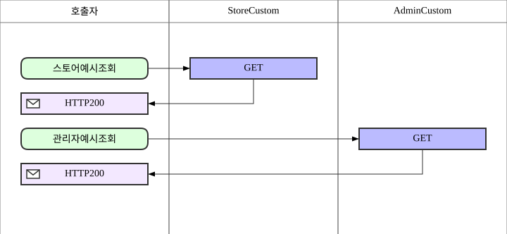
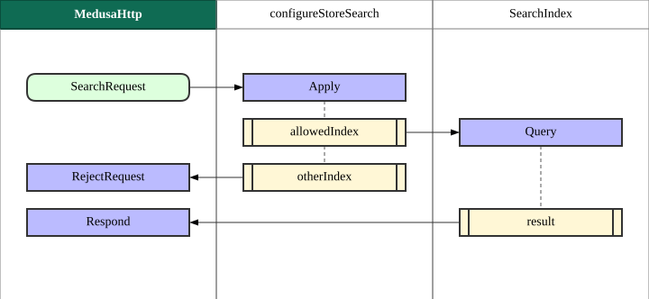
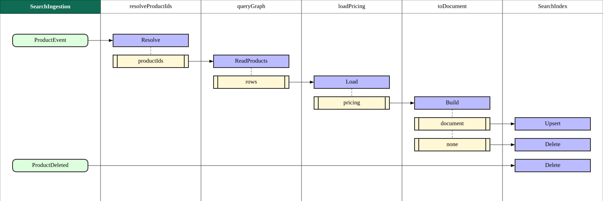
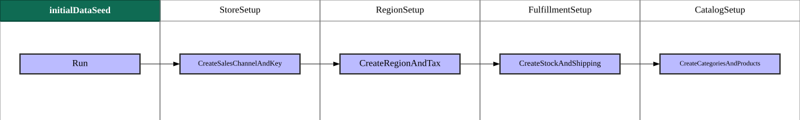
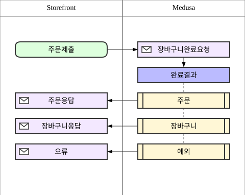

# 커머스 백엔드(apps/backend) 내부 흐름

## 모듈 구성

| 모듈 | 위치 | 책임 | 프로젝트 고유 코드 |
| --- | --- | --- | --- |
| HTTP 계층 | `@medusajs/medusa` 기본 라우트, `src/api/**` | Store·Auth·Admin API, publishable key·인증 검사 | `src/api/middlewares.ts`(`/store/search` 범위), `store/custom`·`admin/custom` 예시(200만 응답) |
| 워크플로 | `@medusajs/core-flows` | 장바구니 완료·주문 생성·이전 등 업무 단계 | 없음(`src/workflows`는 README뿐) |
| 커머스 모듈 | `@medusajs/<module>` | product, pricing, cart, order, customer, auth, payment, region, fulfillment 등 데이터 소유 | 없음(`src/modules`는 README뿐) |
| 검색 색인 | `src/search/product.ts`, `helpers/*` | 상품 문서 정의·변환·이벤트 구독 | 있음 |
| 초기 데이터 | `src/migration-scripts/*`, `src/scripts/seed-demo-products.ts` | 스토어·지역·재고 위치·배송·카테고리·상품 시드 | 있음 |
| 지역 정책 | `src/lib/region-store-policies.ts` | 지역 `metadata`의 정책 키와 기본값 | 있음 |
| Admin 대시보드 | `@medusajs/dashboard` | 운영자 UI(`/app`) | 없음(`src/admin`에 i18n 틀만) |

## B01. 프로젝트가 등록한 Store·Admin 예시 엔드포인트

두 `route.ts`는 `res.sendStatus(200)`을 호출한다. 경로와 메서드는 파일 배치와 `GET` export가 정한다. 공개 키·인증 등 공통 처리는 패키지의 책임이다. [Store 예시](../../../../../../apps/backend/src/api/store/custom/route.ts) · [Admin 예시](../../../../../../apps/backend/src/api/admin/custom/route.ts)

## B02. 상품 검색 요청 범위 지정

- 스토어프론트의 InstantSearch가 `POST /store/search`를 보내면 미들웨어(`src/api/middlewares.ts`)가 요청을 손본다.
- `product` 색인 요청이면 `status`(공개 상품)와 `sales_channel_ids`(키의 판매 채널)로 범위를 좁혀 색인을 조회한다. 두 필드는 필터 전용이라 결과에 나오지 않는다.
- 허용되지 않은 색인이면 거절한다(`allowed_indexes`에 `product`만 있음).
- 검색 결과(제목·핸들·썸네일·카테고리·라벨·옵션 값·통화별 가격 필드)를 돌려준다. 가격 필드는 `eur`, `usd`로 고정되며 스토어프론트의 `SEARCH_PRICE_CURRENCIES`와 맞춰야 한다.

## B03. 상품 검색 색인 갱신

- 상품·변형·옵션 및 옵션 값·태그·카테고리·판매 채널 삭제 관련 이벤트(`PRODUCT_EVENTS`)가 발생하면 색인 갱신을 시작한다. 이벤트는 `{ id }` 하나 또는 묶음으로 온다.
- 이벤트 대상이 상품이 아니면(변형·카테고리 등) `query.graph`로 연결된 상품 ID를 찾는다. 삭제된 행도 soft delete라 `withDeleted`로 따라간다.
- 찾은 상품을 `PRODUCT_GRAPH_FIELDS`(판매 채널·카테고리·태그·옵션 포함)로 읽는다.
- 읽은 행의 통화별 가격을 불러온다.
- 상품 행과 가격으로 검색 문서를 만든다.
- 문서가 만들어지면 색인에 반영한다.
- 문서가 없으면(상품이 사라졌거나 읽히지 않으면) 색인에서 지운다.
- `product.deleted` 이벤트는 문서를 바로 지운다.
- 가격 목록 변경, 가격 목록의 시작·종료일 도래, 판매 채널 일괄 연결, 카테고리 일괄 연결, 변형 가격 직접 갱신은 이벤트가 없어 해당 변경만으로는 자동 반영되지 않는다(코드 TODO, 분석서 I10). 색인 정의에는 이벤트 처리(`consume: graphConsume`)와 전체 적재(`seed: graphSeed`)가 있다. 주석의 catch-up 처리를 언제 실행하는지는 프레임워크 동작이라 미확인이다.

## B04. 초기 데이터 시드

- `medusa db:migrate`가 migration-scripts를 실행하면 초기 시드가 시작된다. 마이그레이션 스크립트라 DB마다 한 번만 실행된다.
- 기본 판매 채널(Default Sales Channel)과 기본 publishable key를 만들고 스토어에 연결한다. 스토어프런트는 해당 판매 채널을 사용할 공개 키를 `NEXT_PUBLIC_MEDUSA_PUBLISHABLE_KEY`로 전달한다.
- 지역 Europe(EUR, gb/de/dk/se/fr/es/it, 결제 `pp_system_default`, 정책 메타데이터 기본값)과 국가별 세금 지역을 만든다.
- 재고 위치(European Warehouse)를 만들고, 기존 기본 배송 프로필을 사용하는 서비스 존과 Standard·Express Shipping(각 10)을 만든다.
- 카테고리(Shirts, Sweatshirts, Pants, Merch)와 상품 4종(T-Shirt, Sweatshirt, Sweatpants, Shorts)과 재고를 만든다.
- `region-store-policies.ts` 마이그레이션은 모든 지역을 읽어 `metadata`에 없는 정책 키만 기본값으로 채운다(`updateRegionsWorkflow`). 이미 값이 있는 키는 바꾸지 않는다.
- `seed-demo-products.ts`는 `medusa exec`로 직접 실행하는 선택 스크립트다. 데모 상품을 최대 50개 생성한다. 컬렉션 4개(Summer Essentials, Winter Layers, Everyday Basics, Limited Run)·태그·공유 옵션의 누락분을 준비하고 상품은 10개씩 생성한다. 기존 핸들은 건너뛴다. 새 상품이 있으면 모든 상품을 25개씩 검색 ingest에 전달하고, 생성 대상이 없으면 그 단계 전에 종료한다.

## B05. 주문 완료에 대한 공개 계약

관찰 지점은 `sdk.store.cart.complete`의 호출과 결과다. 주문 응답은 주문 확인 화면으로 연결되고, 그 외 정상 반환은 카트로 처리된다. 패키지가 적용하는 결제 승인·재고 조정 순서와 보상 트랜잭션은 이 저장소에서 확인할 수 없다. [호출부](../../../../../../apps/storefront/src/lib/data/cart.ts) · [호출자별 분기](../../scenario-state-analysis.md#st06)
