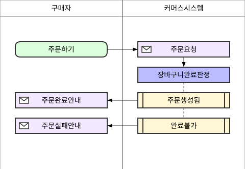
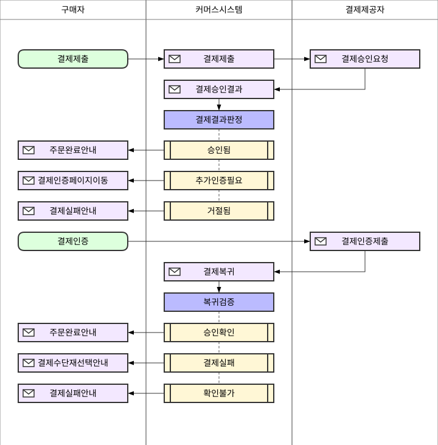
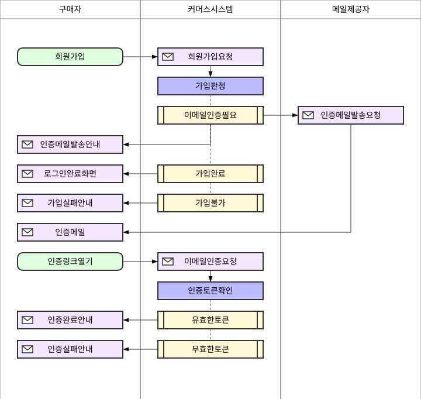
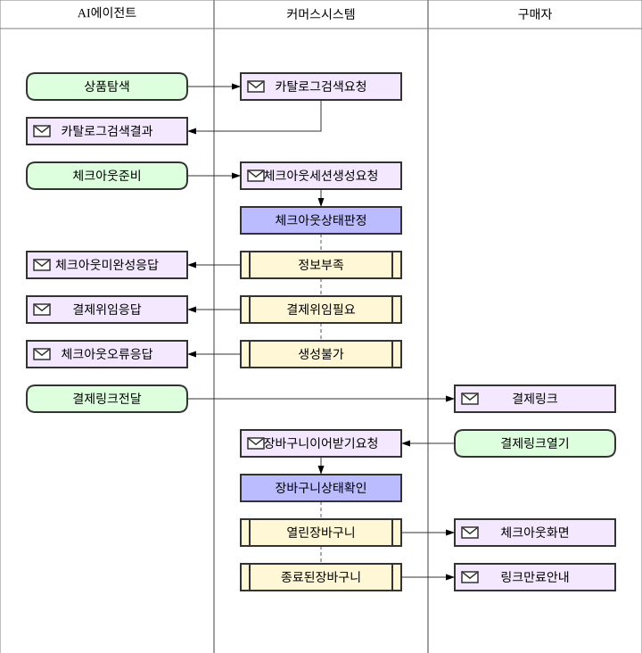
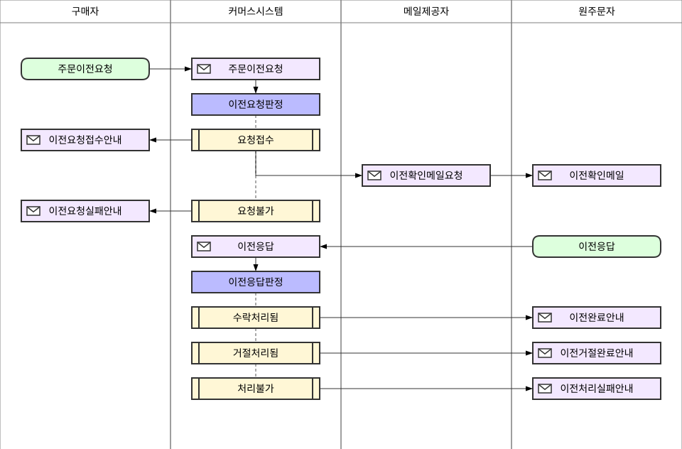

# 매크로뷰: 커머스 시스템과 외부의 관계

## 관찰 경계

- **커머스시스템**: 스토어프론트(`apps/storefront`)와 커머스 백엔드(`apps/backend`), PostgreSQL을 하나로 본다. 화면·Server Action·UCP API·Medusa 모듈의 협력은 [system.md](system.md)에서 연다.
- **외부 객체**

| 외부 객체 | 역할 | 시스템으로 보내는 것 | 시스템에서 받는 것 |
| --- | --- | --- | --- |
| 구매자 | 상품을 찾고 주문하는 사람(비회원·회원) | 장바구니 담기, 주문, 결제 제출, 회원가입·로그인, 인증 링크 열기, 결제 링크 열기, 이전 요청 | 화면(목록·장바구니·체크아웃·주문 완료), 오류 안내, 인증 메일(메일 제공자 경유) |
| 원주문자 | 게스트 주문을 넘겨줄지 정하는 사람 | 이전 수락·거절 | 이전 결과 안내, 이전 확인 메일(미확인) |
| AI 에이전트 | UCP로 상품을 찾고 장바구니를 준비하는 프로그램 | 카탈로그 검색·조회, 장바구니·체크아웃 세션 생성·수정·취소 | 검색 결과, 세션 상태, 구매자에게 넘길 `continue_url` |
| 결제 제공자 | Stripe 계열·Adyen 등. 백엔드 설정에 따라 붙는다(기본 설정은 수동 결제만) | 결제 승인 결과, 구매자 복귀(`return_url`) | 결제 승인 요청 |
| 메일 제공자 | 인증·이전 메일을 보내는 외부 서비스. 기본 설정에 없다 | — | 메일 발송 요청 |
| 운영자 | Medusa Admin에서 상품·지역·주문을 관리 | 상품·지역·정책 변경 | 관리 화면 결과 |

운영자의 관리 작업은 Medusa 기본 Admin의 단순 저장·조회라 독립 그림을 생략했다. 운영자가 바꾼 상품·가격이 검색 색인에 반영되는 과정은 [backend.md B03](backend.md#b03-상품-검색-색인-갱신)에 있다.

## M01. 수동 결제로 주문하기

- 구매자가 검토 단계에서 Place order를 누르면 시스템에 주문을 요청한다.
- 장바구니가 주문으로 바뀌면 시스템은 활성 장바구니 쿠키를 지우도록 요청하고 구매자에게 주문 완료 화면을 보여 준다.
- 완료 요청 예외는 검토 단계에 표시된다. 정상 응답으로 카트가 돌아온 경우 수동 결제 버튼은 안내 없이 다시 활성화될 수 있다.

## M02. 외부 결제를 거쳐 주문하기

- 구매자가 카드 정보나 Drop-in 입력을 제출하면 시스템에 결제를 맡긴다. 결제 위젯은 시스템이 띄우지만 카드 정보는 결제 제공자로 바로 간다.
- 시스템은 결제 제공자에게 결제 승인을 요청한다.
- 결제 제공자는 승인 결과를 시스템에 돌려준다.
- 승인되면(Stripe `succeeded`·`requires_capture`, Adyen 주문 생성) 시스템은 주문을 만들고 주문 완료 화면을 보여 준다.
- 3DS·은행 인증이 필요하면 시스템은 구매자를 결제 제공자의 인증 페이지로 보낸다. 인라인으로 끝나는 카드 결제는 이 경로를 거치지 않는다.
- 결제가 거절되면 시스템은 검토 단계에 오류 메시지를 보여 준다.
- 구매자가 인증 페이지에서 인증하면 결제 제공자에게 결과가 제출된다.
- 결제 제공자는 구매자를 `return_url`(`/api/payment-return?cart_id&country_code`)로 돌려보낸다. 이 복귀는 데이터가 담긴 브라우저 이동이다.
- 복귀 파라미터가 장바구니의 결제 세션과 맞고 주문이 만들어지면 시스템은 주문 완료 화면을 보여 준다.
- Stripe가 `redirect_status=failed`로 돌려보내면 시스템은 체크아웃 결제 단계로 보내 다른 수단을 고르게 한다.
- 파라미터가 없거나 맞지 않거나 주문 생성에 실패하면 시스템은 장바구니 화면으로 보낸다. 실패 사유 쿼리는 붙지만 화면에 표시되지 않는다(분석서 I01).
- 결과 불명(제공자 응답 지연)을 다시 확인하는 처리는 스토어프론트에 없다. 결제 제공자의 웹훅 처리는 백엔드 결제 모듈 설정에 달려 있어 미확인이다.

## M03. 회원가입과 이메일 인증

- 구매자가 이름·이메일·비밀번호로 가입을 요청한다.
- 백엔드가 이메일 인증을 요구하면 시스템은 메일 제공자에게 인증 메일을 요청한다. 가입 입력값은 첫 로그인까지 쿠키에 보관한다.
- 같은 경우 구매자에게는 "인증 링크를 보냈다"는 안내를 같은 화면에 보여 준다.
- 인증이 필요 없으면 시스템이 고객을 만들고 로그인시켜 계정 화면을 보여 준다.
- 입력 오류·이미 있는 계정 등으로 가입할 수 없으면 오류 메시지를 보여 준다. 같은 이메일의 다른 identity가 이미 있으면 로그인 시도로 이어진다.
- 메일 제공자가 구매자에게 인증 메일을 보낸다. 메일 링크 주소를 만드는 곳은 미확인이다.
- 구매자가 인증 링크(`/{cc}/verify-account?token=`)를 열면 시스템에 인증을 요청한다.
- 토큰이 유효하면 인증 완료와 로그인 이동 버튼을 보여 준다. 고객 레코드는 다음 로그인 때 만든다.
- 토큰이 없거나 만료됐으면 다시 로그인해 새 메일을 받으라고 안내한다.

## M04. AI 에이전트의 장바구니 위임

- 에이전트는 `/ucp/v1/catalog/search`·`lookup`(또는 MCP)으로 상품을 찾는다.
- 시스템은 상품·가격 목록을 돌려준다.
- 에이전트가 품목·배송지·구매자 이메일로 체크아웃 세션을 요청한다. `Idempotency-Key`가 있으면 같은 서버 인스턴스 안에서 중복 생성을 막는다.
- 이메일이나 배송지가 없으면 `incomplete` 상태와 빠진 항목을 돌려준다.
- 정보가 갖춰지면 `requires_escalation` 상태와 `continue_url`을 돌려준다. 이 스토어는 API로 결제를 받지 않으므로 완료(`complete`) 요청도 같은 응답을 준다.
- 품목·국가가 맞지 않거나 장바구니를 찾지 못하면 UCP 오류를 돌려준다.
- 에이전트가 구매자에게 `continue_url`을 전달한다. 전달 방법은 시스템 밖의 일이다.
- 구매자가 링크(`/{cc}/cart/resume/{cartId}`)를 열면 시스템에 장바구니를 넘겨 달라고 요청한다.
- 장바구니가 열려 있으면 쿠키에 넣고 체크아웃 화면을 연다. `step`이 없는 인계 화면에서 필요한 경우 카트로 돌아가 Go to checkout을 눌러 단계를 연다.
- 장바구니가 완료됐거나 에이전트가 취소했으면 410 평문("This cart link has expired")을 보여 준다.
- 퍼머링크 `/buy/{variant}:{qty}`는 같은 결과를 에이전트 없이 링크 하나로 만든다. 판단은 [storefront.md S02](storefront.md#s02-장바구니-담기-폼과-퍼머링크)에 있다.

## M05. 주문 소유권 이전

- 로그인한 구매자가 주문 목록 하단에 주문 ID를 넣어 이전을 요청한다.
- 요청이 접수되면 구매자에게 같은 화면에서 안내한다.
- 같은 결과로 원주문자에게 확인 메일을 요청한다. 실제 발송 여부는 백엔드 알림 설정에 달려 있어 미확인이다.
- 주문 ID가 없거나 이전할 수 없는 주문이면 오류 메시지를 보여 준다.
- 메일 연동이 구성된 경우에 기대하는 외부 단계에서 원주문자에게 확인 링크(`/{cc}/order/{id}/transfer/{token}`)를 보낸다.
- 원주문자가 수락 또는 거절하면 시스템에 응답한다. `…/accept`, `…/decline` 주소를 직접 열어도 같은 요청이 된다(분석서 I05).
- 수락이 반영되면 주문이 새 고객에게 넘어갔다고 안내한다.
- 거절이 반영되면 이전을 거절했다고 안내한다.
- API가 수락·거절 요청에 오류를 반환하면 원인 메시지를 보여 준다. 요청한 구매자에게 결과를 알리는 처리는 스토어프론트에 없다(미확인).
