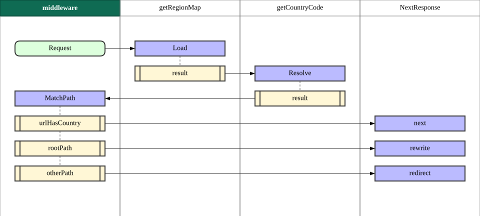
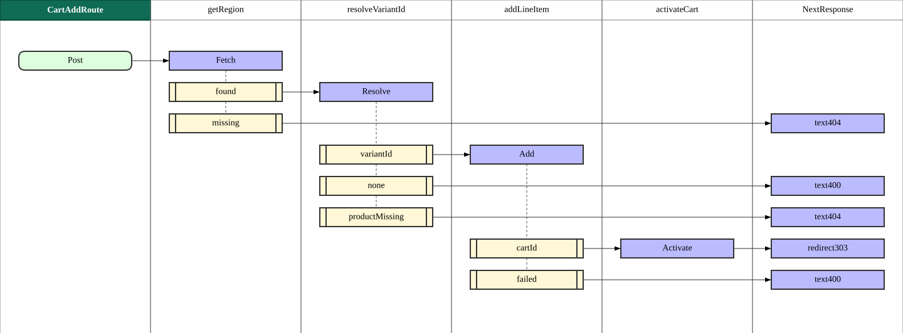
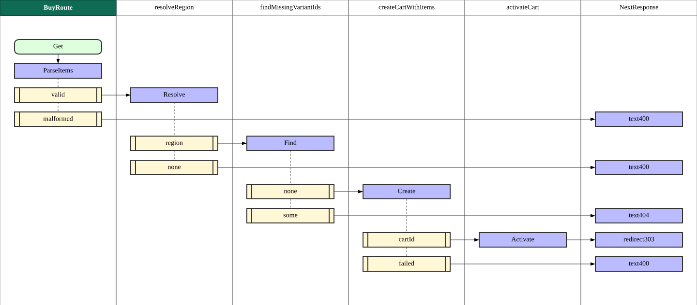
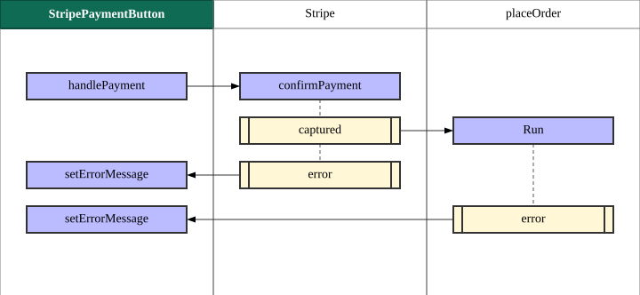
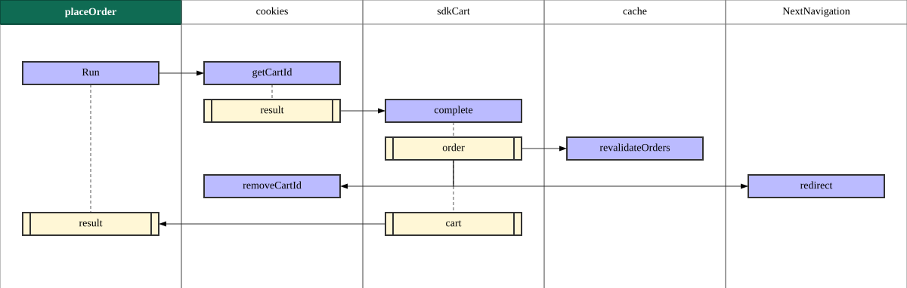
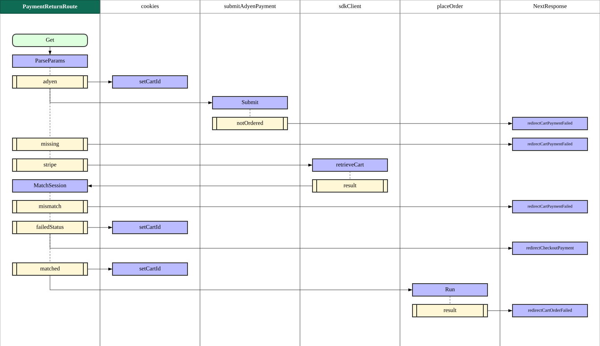
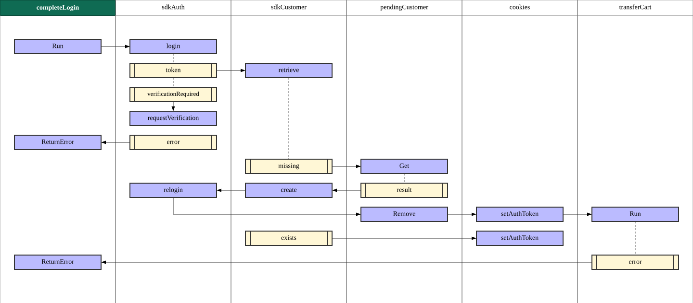
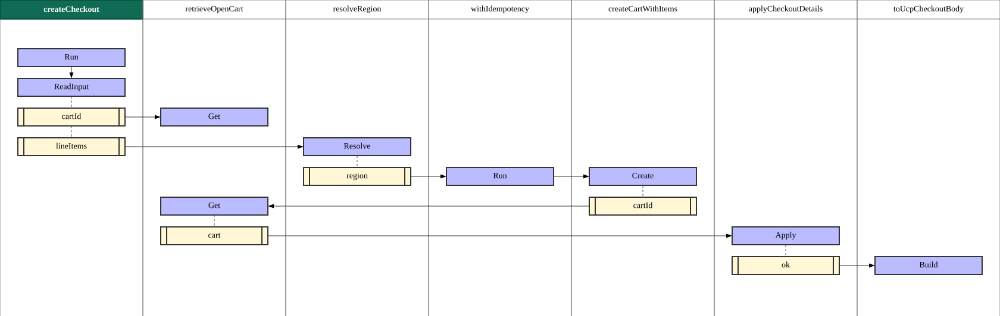
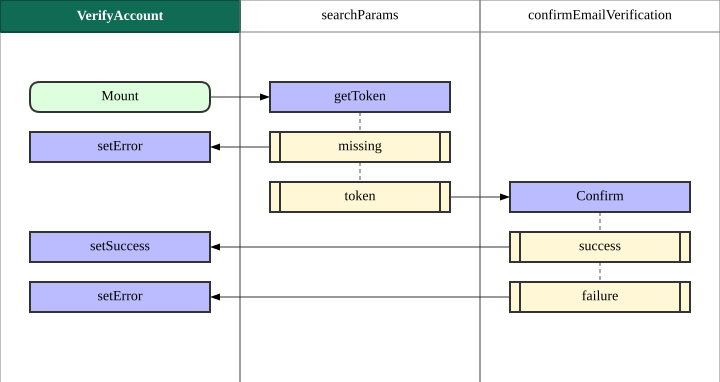
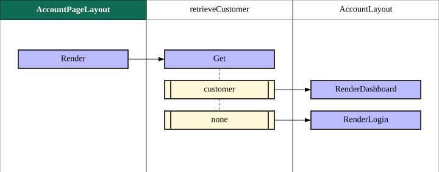

# 스토어프론트(apps/storefront) 내부 흐름

## 모듈 구성

| 모듈 | 위치 | 책임 |
| --- | --- | --- |
| 라우팅 미들웨어 | `src/middleware.ts` | 국가 코드 확인·rewrite·redirect, 캐시 ID 쿠키 |
| 페이지·레이아웃 | `src/app/[countryCode]/**` | 서버 컴포넌트에서 데이터 조회, `notFound()` 판단, 슬롯 선택 |
| 데이터 접근 | `src/lib/data/*` | `"use server"` 함수. SDK 호출·캐시 태그 무효화·쿠키·`redirect()` |
| 장바구니 서버 도우미 | `src/lib/util/server-cart.ts` | 지역 해석, 품목 포함 장바구니 생성, 쿠키 활성화 |
| Route Handler | `cart/add`, `cart/resume`, `buy`, `api/payment-return` | 폼·링크·결제 복귀를 처리하고 redirect·평문 응답 |
| UCP | `src/app/ucp/**`, `src/lib/ucp/*` | UCP REST·MCP 요청을 장바구니 작업으로 변환 |
| 화면 모듈 | `src/modules/*` | 클라이언트 컴포넌트(폼, 결제 버튼, InstantSearch) |
| SDK 클라이언트 | `src/lib/config.ts` | `@medusajs/js-sdk` 인스턴스, publishable key·로케일 헤더 |

아래 그림은 구현 심볼을 쓴 모듈 수준 확대다. `NextResponse`·`NextNavigation`은 Next.js가 응답과 화면 이동을 만드는 지점을 뜻한다.

## S01. 국가 코드 라우팅

- 요청이 들어오면(정적 파일·`api`·`ucp`·`buy` 제외) 미들웨어가 지역 맵을 불러온다. 맵은 메모리에 1시간 보관하고, 비었거나 오래되면 `/store/regions`를 다시 부른다. 백엔드 URL이 없거나 응답이 실패하면 예외로 요청 전체가 실패한다.
- 지역 맵을 받으면 URL 첫 세그먼트 → `NEXT_PUBLIC_DEFAULT_REGION` → 맵의 첫 국가 순서로 국가를 정한다.
- 정한 국가로 미들웨어가 경로를 판정한다.
- 경로가 이미 그 국가로 시작하면 그대로 통과시키고, 캐시 ID 쿠키가 없으면 만든다.
- 경로가 `/`이면 기본 국가 홈을 같은 주소로 보여 준다(redirect 없이 rewrite).
- 그 밖에는 `/{country}{path}{query}`로 307 redirect한다.

## S02. 장바구니 담기 폼과 퍼머링크

- 상품 상세 폼이 JavaScript 없이 `POST /{cc}/cart/add`로 제출되면 국가 코드로 지역을 찾는다.
- 지역이 있으면 폼의 `options[...]` 값과 일치하는 변형을 찾거나, 옵션이 없으면 `variant_id`를 그대로 쓴다.
- 지역이 없으면 "Unknown country code" 404 평문을 돌려준다.
- 변형을 찾으면 장바구니 쿠키의 장바구니(없으면 새로 만든 장바구니)에 수량(1~100)을 추가한다.
- 변형을 정할 수 없으면 "Select a valid product variant" 400 평문을 돌려준다.
- 상품 조회가 실패하면 "Product not found" 404 평문을 돌려준다.
- 추가에 성공하면 장바구니 ID를 쿠키에 넣고 캐시를 무효화한다. 기존 장바구니에서 실패하면 새 장바구니로 한 번 다시 시도한 결과다.
- 새 장바구니에서도 실패하면 오류 메시지 400 평문을 돌려준다.
- 쿠키를 활성화하면 `/{cc}/cart`로 303 이동한다.

- `/buy/{items}` 요청이 오면 경로를 `{variant}:{qty},...`로 해석한다. `~`로 시작하는 ID는 base64url로 풀어 쓴다.
- 형식이 맞으면 `context/address_country` 쿼리로 지역을 찾는다.
- 형식이 틀리거나 수량이 100을 넘으면 사용법이 담긴 400 평문을 돌려준다.
- 지역을 찾으면 없는 변형이 있는지 확인한다.
- 배송할 수 없는 국가면 400 평문을 돌려준다.
- 모든 변형이 있으면 품목을 담은 장바구니를 만든다.
- 없는 변형이 있으면 ID 목록을 담은 404 평문을 돌려준다.
- 장바구니를 만들면 쿠키를 활성화한다.
- 만들지 못하면 "One or more items in this link can't be purchased" 400 평문을 돌려준다.
- 쿠키를 활성화하면 `/{국가}/checkout`으로 303 이동한다. `/{cc}/cart/resume/{cartId}`는 장바구니를 조회해 열려 있으면 같은 방식으로 단계가 접힌 체크아웃으로 보내고, 아니면 410 평문을 돌려준다.

## S03. 주문하기 버튼과 placeOrder

- 구매자가 Place order를 누르면 Stripe 버튼이 청구지 정보와 `return_url`을 넣어 결제 확인을 요청한다(`redirect: "if_required"`). 외부 인증이 필요한 수단이면 브라우저가 결제 제공자로 이동하고 이 흐름은 끝난다.
- 결제가 `succeeded`·`requires_capture`면(오류 응답이지만 결제 의도가 그 상태인 경우 포함) 주문을 만든다.
- 그 밖의 오류면 결제 오류 문구를 버튼 아래에 보여 준다.
- 완료 요청이 예외를 던지면 오류를 표시한다. 카트 응답이 반환되면 수동·Stripe 버튼은 별도 안내 없이 검토 단계에 남을 수 있다. 성공하면 `placeOrder` 안의 `redirect()`가 주문 완료 화면으로 이동시킨다.
- 수동 결제 버튼(`ManualTestPaymentButton`)은 결제 확인 없이 바로 `placeOrder.Run`을 부른다. Adyen은 Drop-in의 `onSubmit`에서 `submitAdyenPayment`를 부르고, 추가 동작이 있으면 Drop-in에 넘기며 아니면 오류를 보여 준다.

- 주문을 시작하면 인자로 받은 장바구니 ID 또는 쿠키의 장바구니 ID를 쓴다. 둘 다 없으면 예외를 던진다.
- 장바구니 ID로 완료를 요청하고, 요청이 정상 반환되면 장바구니 캐시를 무효화한다. HTTP 오류는 `medusaError`가 예외로 바꾼다.
- 주문이 생기면 주문 캐시를 무효화한다.
- 주문이 생기면 장바구니 쿠키를 지운다.
- 주문이 생기면 `/{배송 국가}/order/{id}/confirmed`로 이동한다.
- 주문이 생기지 않으면 장바구니를 호출자에게 돌려준다. 수동·Stripe 인라인 버튼은 카트 반환값을 표시하지 않으며 외부 복귀 핸들러는 실패 주소로 보낸다.

## S04. 결제 복귀 처리

- 결제 제공자에서 돌아오면 쿼리(`cart_id`, `country_code`, `payment_intent`, `payment_intent_client_secret`, `redirect_status`, `redirectResult`)를 읽는다.
- `cart_id`와 `redirectResult`가 있으면(Adyen) 장바구니 쿠키를 복원한다.
- 같은 경우 결제 세션에 복귀 결과를 넘기고 주문을 시도한다. 주문이 생기면 내부 `redirect()`가 완료 화면으로 보낸다(`unstable_rethrow`로 전달).
- 주문이 생기지 않으면 `/{cc}/cart?error=payment_failed`로 보낸다.
- 필수 파라미터가 빠졌으면 같은 실패 주소로 보낸다.
- Stripe 파라미터가 있으면 결제 세션 데이터가 담긴 장바구니를 `no-store`로 조회한다. 조회 실패는 `null`로 다룬다.
- 장바구니를 받으면 세션 `data.id`가 `payment_intent`와 같고 `client_secret`가 같은지 대조한다.
- 맞는 세션이 없으면 결제 실패 주소로 보낸다.
- `redirect_status=failed`면 장바구니 쿠키를 복원한다.
- 같은 경우 Stripe 파라미터를 유지한 채 `/{cc}/checkout?step=payment`로 보낸다.
- 세션이 맞으면 장바구니 쿠키를 복원한다.
- 같은 경우 주문을 시도한다. 성공하면 내부 `redirect()`가 완료 화면으로 보낸다.
- 주문이 생기지 않거나 예외가 나면 `/{cc}/cart?error=order_failed`로 보낸다.

## S05. 로그인 처리(completeLogin)

- 로그인·회원가입 Server Action이 이메일·비밀번호로 로그인을 요청한다.
- 문자열 토큰을 받으면 그 토큰으로 내 고객을 조회한다.
- `verification_required`면 인증 메일을 요청하고 `{ state: "verification_required" }`를 돌려준다. `location`(외부 인증 제공자)이나 다른 객체면 지원하지 않는다는 오류를 돌려준다.
- 로그인 오류면 `{ state: "error" }`를 돌려준다.
- 고객이 없으면 대기 고객 쿠키를 읽는다.
- 쿠키의 이름·전화번호로 고객을 만든다.
- 고객을 만들면 다시 로그인해 고객이 연결된 토큰을 받는다. 생성·재로그인 실패는 오류로 돌려준다.
- 재로그인하면 대기 고객 쿠키를 지운다.
- 고객이 이미 있으면 토큰 쿠키를 저장하고 고객 캐시를 무효화한다.
- 새 고객도 같은 방식으로 토큰을 저장한다.
- 토큰을 저장하면 익명 장바구니를 고객에게 이전한다. 장바구니 쿠키가 없으면 아무것도 하지 않는다.
- 이전이 실패하면 오류를 돌려준다. 성공하면 `{ state: "success" }`이고, 캐시 무효화로 `/account` 레이아웃이 대시보드 슬롯을 다시 그린다.

## S06. UCP 체크아웃 세션

- `POST /ucp/v1/checkout-sessions`(또는 MCP 도구)가 들어오면 입력을 읽는다.
- `cart_id`가 있으면 열린 장바구니를 조회한다. 없으면 404 `not_found`를 돌려준다.
- 품목이 있으면 배송 국가(없으면 context 국가)로 지역을 찾는다. 품목이 없거나 형식이 틀리면 `invalid_request`, 지역이 없으면 `unsupported_country` 오류다.
- 지역을 찾으면 `Idempotency-Key`로 중복 실행을 막는다. 결과는 메모리에 보관하므로 같은 서버 인스턴스에서만 효과가 있다.
- 장바구니를 만든다. 실패하면 `item_unavailable`이다.
- 장바구니 ID로 열린 장바구니를 다시 조회한다.
- 장바구니가 있으면 구매자 이메일과 첫 배송지 등 체크아웃 정보를 반영한다. 오류는 UCP 오류로 돌려준다.
- 반영이 끝나면 장바구니를 UCP 응답으로 바꾼다. 이메일·배송지가 없으면 `incomplete`, 다 있으면 `requires_escalation`과 `continue_url`이다. `complete` 요청은 `getCheckout`과 같아서 결제 없이 같은 상태를 돌려준다. `cancel`은 장바구니 `metadata.ucp_canceled=true`로 표시한다.

## S07. 이메일 인증 화면

- 인증 링크로 페이지가 열리면 컴포넌트가 한 번만(Strict Mode 중복 방지) URL의 `token`을 읽는다.
- 토큰이 없으면 오류 장면을 보여 준다.
- 토큰이 있으면 인증 확인을 요청한다. 이 요청은 로그인 없이 동작한다.
- 확인되면 성공 장면을 보여 준다.
- 실패하면 "invalid or has expired" 오류 장면을 보여 준다.

## S08. 계정 영역 슬롯 선택

- `/{cc}/account/**`를 그릴 때 레이아웃이 토큰 쿠키로 고객을 조회한다. 조회 오류는 `null`로 다룬다.
- 고객이 있으면 왼쪽 계정 메뉴와 `@dashboard` 슬롯(개요·프로필·주소·주문)을 그린다.
- 고객이 없으면 어떤 하위 경로든 `@login` 슬롯(로그인·회원가입)을 그린다. 로그인에 성공하면 같은 URL이 대시보드로 다시 그려진다.
