# Medusa DTC 스토어프론트 AS-IS Navigation

## 범위·확인 기준

- 대상: `apps/storefront`의 구매자 화면 25개 페이지 전체(목록은 [screen-layout.md](screen-layout.md#전체-페이지장면-목록)). 기준 커밋 `0b24157`.
- 코드만 읽은 정적 분석이다. 화면 링크는 코드에서 재현한 로컬 HTML로 연결한다. 분석 근거·API 대응·미확인은 [system-design-as-is.md](system-design-as-is.md)에 모았다.
- 구매자 페이지 경로 앞에 `/{countryCode}`가 붙는다(예: `/dk/cart`). 화면 노드는 실제 라우트 페이지이고, 라우트 없는 오버레이·단계·오류는 `Page(장면)`으로 표기한다.
- API 노드는 논리 이름이다. 실제 호출 대응은 [system.md](details/job-flow/system.md#그-밖의-서비스-간-호출)에 있다. 화면 HTML은 예시 데이터로 장면을 바꾸며 서버를 호출하지 않는다.

## N01. 국가 진입과 국가 변경

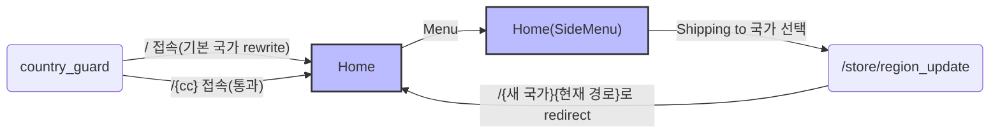

- 국가 처리 대상 페이지에서는 `country_guard`가 먼저 지역 맵을 읽는다. `/api`·`/ucp`·`/buy`와 정적 자산은 별도 경로로 처리된다. 첫 세그먼트가 백엔드 지역의 국가면 통과, `/`면 설정된 기본 국가(기본값 `dk`), 또는 지역 목록의 첫 국가 홈을 같은 주소로 보여 준다. 그 밖의 경로는 `/{국가}{경로}`로 307 redirect한다. 그림은 홈을 대표로 그렸다.
- 사이드 메뉴의 국가 선택은 장바구니 지역을 바꾸고 현재 페이지를 새 국가 경로로 다시 연다. 지원 로케일이 있으면 언어 선택을 표시한다. 언어 쿠키와 기존 카트의 locale을 갱신하고 같은 경로를 새로고침한다.
- 사이드 메뉴의 Home·Store·Account·Cart는 각 페이지로 이동한다.

### 화면 확인 링크

| 페이지·장면 | 화면 HTML | Layout |
| --- | --- | --- |
| Home · 사이드 메뉴 | [기본](details/screens/home.html#default) · [사이드 메뉴](details/screens/home.html#side-menu) | [배치·장면](screen-layout.md#home) |

## N02. 상품 목록 탐색

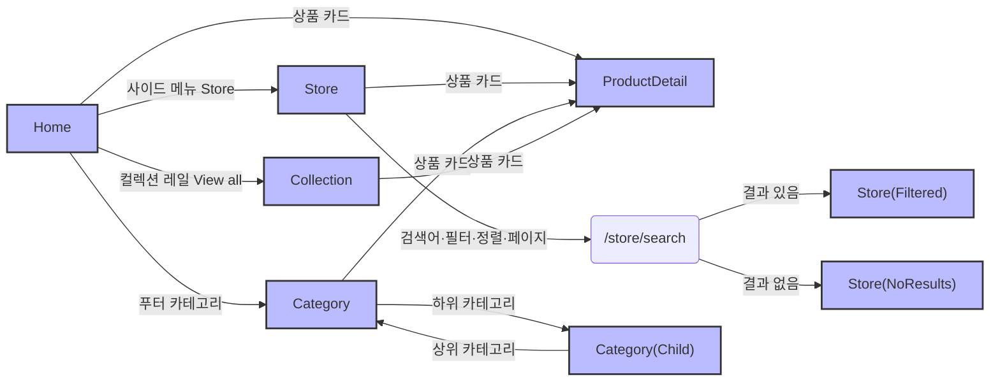

- 홈은 컬렉션별 상품 레일을 보여 준다. 지역이나 컬렉션 응답 자체가 없으면 본문을 생략한다. 빈 컬렉션 배열이면 Hero만 남는다.
- Store는 InstantSearch로 `/store/search`를 부르며 정렬·옵션·가격·카테고리 필터와 검색어·페이지를 URL 쿼리(`routing`)에 반영한다. 같은 페이지 안의 장면 변화다.
- Category·Collection은 서버에서 상품을 조회하고 정렬과 페이지를 쿼리로 바꾼다. 옵션 선택 UI는 숨기지만 URL의 `optionValueIds`를 Store API의 `option_value_id`로 전달한다. 정렬·페이지 계산 대상은 조회한 최대 100개다. 없는 핸들이면 [NotFound](#n19)다. 상품이 없으면 빈 목록이 보인다.

### 화면 확인 링크

| 페이지·장면 | 화면 HTML | Layout |
| --- | --- | --- |
| Home · 기본 | [기본](details/screens/home.html#default) | [배치·장면](screen-layout.md#home) |
| Store · 필터 적용·결과 없음·2페이지 | [기본](details/screens/store.html#default) · [필터 적용](details/screens/store.html#filtered) · [결과 없음](details/screens/store.html#no-results) · [2페이지](details/screens/store.html#page-2) | [배치·장면](screen-layout.md#store) |
| Category · 하위 카테고리·상품 없음 | [기본](details/screens/category.html#default) · [하위 카테고리](details/screens/category.html#child) · [상품 없음](details/screens/category.html#empty) | [배치·장면](screen-layout.md#category) |
| Collection · 상품 없음 | [기본](details/screens/collection.html#default) · [상품 없음](details/screens/collection.html#empty) | [배치·장면](screen-layout.md#collection) |
| ProductDetail · 기본 | [기본](details/screens/product-detail.html#default) | [배치·장면](screen-layout.md#product-detail) |

## N03. 상품 검색

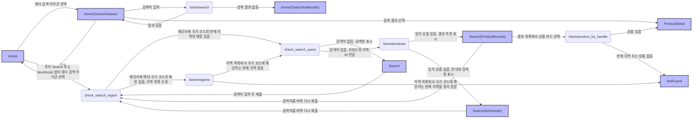

- 헤더 검색 아이콘은 JavaScript가 있으면 현재 페이지 위에 검색 드로어를 연다. 입력 후 250ms를 기다려 상품 색인을 검색하고 최대 12건을 요청한다. 빈 입력 안내, 검색 중, 요청 실패, 결과 없음과 일치 상품을 구분한다. 그림의 `Home(SearchDrawer)`는 모든 `(main)` 페이지에서 열리는 같은 오버레이를 대표한다.
- 푸터 Search를 누르거나 JavaScript 없이 헤더 검색 아이콘을 선택하면 `/{cc}/search`로 이동한다. Next.js 서버에서 `getRegion(countryCode)`를 실행한다. 국가별 매핑이 메모리에 없으면 `listRegions()`로 Medusa의 `GET /store/regions`를 조회한다. 이 조회에는 Next.js 데이터 캐시가 적용된다.
- 판매 지역을 찾으면 검색어 유무에 따라 검색창을 표시하거나 상품 목록을 조회한다. 폼은 `GET /{cc}/search?q=…`로 제출되며, 같은 페이지에 결과 목록(최대 24개)이나 "No products match your search." 안내가 표시된다.

### 화면 확인 링크

| 페이지·장면 | 화면 HTML | Layout |
| --- | --- | --- |
| Home · 검색 드로어 결과·결과 없음 | [기본](details/screens/home.html#default) · [검색 드로어 결과](details/screens/home.html#search-drawer) · [검색 드로어 결과 없음](details/screens/home.html#search-no-results) · [검색 입력 전](details/screens/home.html#search-start) · [검색 중](details/screens/home.html#search-pending) · [검색 요청 실패](details/screens/home.html#search-error) | [배치·장면](screen-layout.md#home) |
| Search · 결과·결과 없음 | [기본](details/screens/search.html#default) · [결과](details/screens/search.html#results) · [결과 없음](details/screens/search.html#no-results) | [배치·장면](screen-layout.md#search) |
| ProductDetail · 기본 | [기본](details/screens/product-detail.html#default) | [배치·장면](screen-layout.md#product-detail) |
| NotFound · 기본 | [기본](details/screens/not-found.html#default) | [배치·장면](screen-layout.md#not-found) |

## N04. 상품 상세와 장바구니 담기

### 상품 상세 열기와 옵션 선택

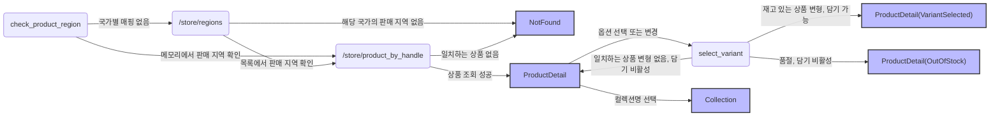

- 상품 카드를 누르거나 `/{cc}/products/{handle}`을 직접 열면, 상세를 생성하는 Next.js 서버 코드가 판매 지역과 상품을 조회한다. 정적 렌더링과 캐시가 적용된다. 관련 상품은 별도의 상품 목록 조회로 표시한다.
- 초기 선택은 재고 있는 첫 상품 변형이며, 전부 품절이면 첫 변형을 사용한다. JavaScript가 실행되면 이미 로드한 상품 변형에서 옵션 조합을 찾고 URL의 `v_id`를 갱신한다. 옵션에 맞는 변형이 없으면 `Select variant`, 품절이면 `Out of stock`이 표시된다.

### JavaScript 사용 시 담기

```mermaid
graph LR
    N0["ProductDetail(VariantSelected)"]
    N1("add_to_cart")
    N2("/store/regions")
    N3("check_cart_cookie")
    N4("/store/cart_retrieve")
    N5("/store/carts")
    N6("/store/cart_update")
    N7("/store/line_items")
    N8("/store/cart_after_add")
    N9["ProductDetail(CartDropdown)"]
    N10["Cart"]

    N0 -->|"Add to cart, Next.js Server Action 실행"| N1
    N1 -->|"국가별 매핑 없음"| N2
    N1 -->|"메모리에서 판매 지역 확인"| N3
    N2 -->|"목록에서 판매 지역 확인"| N3
    N2 -->|"판매 지역 없음, 요청 실패"| N0
    N3 -->|"장바구니 ID 쿠키 있음"| N4
    N3 -->|"장바구니 ID 쿠키 없음"| N5
    N4 -->|"장바구니를 가져오지 못함"| N5
    N4 -->|"장바구니와 현재 페이지의 판매 지역이 다름"| N6
    N4 -->|"장바구니와 현재 페이지의 판매 지역이 같음"| N7
    N5 -->|"생성 성공, 장바구니 ID를 쿠키에 저장"| N7
    N6 -->|"지역 갱신 성공"| N7
    N5 -->|"생성 실패, 상세에 머무름"| N0
    N6 -->|"지역 갱신 실패, 상세에 머무름"| N0
    N7 -->|"담기 실패, 상세에 머무름"| N0
    N7 -->|"담기 성공, 헤더가 서버에서 장바구니를 받지 못한 경우 재조회"| N8
    N7 -->|"담기 성공, 헤더가 받은 장바구니의 수량 변화 확인"| N9
    N8 -->|"장바구니 수량 변화 확인"| N9
    N8 -->|"수량 변화 확인 안 됨, 상세에 머무름"| N0
    N9 -->|"Go to cart"| N10

    style N0 fill:#bbf,stroke:#333,stroke-width:2px
    style N9 fill:#bbf,stroke:#333,stroke-width:2px
    style N10 fill:#bbf,stroke:#333,stroke-width:2px
```

- `addToCart`가 선택한 상품 변형 ID와 수량 1을 보낸다. 장바구니 생성·지역 갱신·품목 추가 요청이 실패하면 상세에 머무른다. 현재 구현은 오류 문구를 표시하지 않으며, 예외가 발생하면 담기 버튼의 로딩 상태를 해제하는 코드에 도달하지 않는다.

### JavaScript 없이 담기

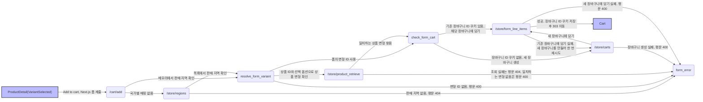

- JavaScript 없는 폼은 기존 장바구니를 조회하거나 지역을 갱신하는 별도 요청 없이 쿠키의 ID로 담기를 시도한다. 평문 오류 응답은 `form_error`에 표시했다.

### API 노드 대응

| 다이어그램 노드 | 실제 HTTP 요청 |
| --- | --- |
| `(/store/regions)` | Medusa `GET /store/regions` |
| `(/store/product_by_handle)` | Medusa `GET /store/products?handle={handle}&region_id={regionId}` |
| `(/cart/add)` | Next.js `POST /{cc}/cart/add` |
| `(/store/product_retrieve)` | Medusa `GET /store/products/{productId}` (`region_id`와 변형·옵션 필드 포함) |
| `(/store/cart_retrieve)` / `(/store/cart_after_add)` | Medusa `GET /store/carts/{cartId}` (기존 장바구니 확인 / 담은 후 헤더 갱신) |
| `(/store/carts)` | Medusa `POST /store/carts` (`region_id` 포함) |
| `(/store/cart_update)` | Medusa `POST /store/carts/{cartId}` (`region_id` 갱신) |
| `(/store/line_items)` / `(/store/form_line_items)` | Medusa `POST /store/carts/{cartId}/line-items` (`variant_id`, `quantity` 포함) |

- 상세의 메타데이터 생성과 공통 헤더의 국가 선택에도 `GET /store/regions`가 쓰인다. 관련 상품은 `GET /store/products`를 사용하며, 현재 상품의 컬렉션·태그가 있으면 필터에 포함한다.
- 공통 헤더·푸터는 `GET /store/locales`, `GET /store/collections`, `GET /store/product-categories`도 사용한다. 공통 레이아웃은 인증 토큰이 있으면 `GET /store/customers/me`, 장바구니 ID가 있으면 `GET /store/carts/{cartId}`, 장바구니 조회에 성공하면 `GET /store/shipping-options?cart_id={cartId}`를 사용한다. 헤더도 장바구니를 조회하며, 서버에서 장바구니를 받지 못한 경우 브라우저에서 Server Action을 실행해 장바구니를 가져온다.
- SDK로 캡슐화된 요청은 앱의 `sdk.store.cart` 호출과 인자를 기준으로 정리했다.

### 화면 확인 링크

| 페이지·장면 | 화면 HTML | Layout |
| --- | --- | --- |
| ProductDetail · 옵션 선택·품절·장바구니 드롭다운 | [기본](details/screens/product-detail.html#default) · [옵션 선택](details/screens/product-detail.html#variant-selected) · [일치하는 변형 없음](details/screens/product-detail.html#no-match) · [품절](details/screens/product-detail.html#out-of-stock) · [장바구니 드롭다운](details/screens/product-detail.html#cart-dropdown) · [모바일 구매 바](details/screens/product-detail.html#mobile-options) · [상품 생성 안내](details/screens/product-detail.html#onboarding) | [배치·장면](screen-layout.md#product-detail) |
| Cart · 기본 | [기본](details/screens/cart.html#default) | [배치·장면](screen-layout.md#cart) |
| Collection · 기본 | [기본](details/screens/collection.html#default) | [배치·장면](screen-layout.md#collection) |
| NotFound · 기본 | [기본](details/screens/not-found.html#default) | [배치·장면](screen-layout.md#not-found) |
| 담기 폼 오류 | Next.js 평문 HTTP 응답 | 해당 없음 |

## N05. 장바구니 관리와 체크아웃 시작

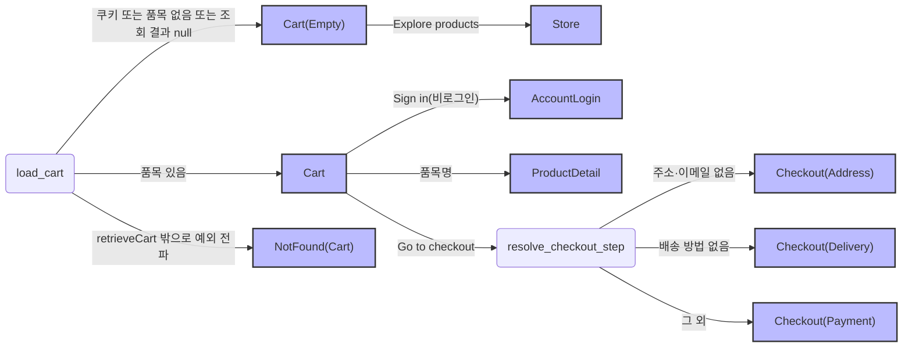

- 조건부 무료 배송 요금이 적용되면 공통 셸에서 남은 금액 팝업으로 Cart 또는 Store에 갈 수 있다. `/cart` 진입·새로고침 시 장바구니를 조회한다. 쿠키가 없거나 SDK 조회 오류를 `null`로 처리하면 빈 장바구니를 보여 준다. 별도로 `retrieveCart` 밖에 전파된 예외를 페이지가 잡으면 장바구니 전용 404를 선택한다.
- 수량 변경·삭제·프로모션 코드 적용은 같은 페이지에서 처리하고 이동하지 않는다. 수량 오류는 해당 품목 아래, 프로모션 추가 오류는 코드 폼에 표시한다. 삭제 실패에는 별도 안내가 없다.
- Go to checkout은 장바구니 상태로 첫 미완료 단계를 골라 `Checkout?step=`로 보낸다. 로그인은 필요 없다.
- 비로그인이면 Sign in 안내가 보이고 `AccountLogin`으로 간다. 로그인 후 장바구니로 돌아오지 않는다(분석서 I02).
- 로그인 고객과 장바구니가 있고 `cart.customer_id`가 비어 있으면 모든 `(main)` 페이지 상단에 "Run transfer again" 배너가 뜬다. 이동은 없다.

### 화면 확인 링크

| 페이지·장면 | 화면 HTML | Layout |
| --- | --- | --- |
| Cart · 로그인 상태·빈 장바구니·로딩 | [기본](details/screens/cart.html#default) · [로그인 상태](details/screens/cart.html#signed-in) · [빈 장바구니](details/screens/cart.html#empty) · [로딩](details/screens/cart.html#loading) | [배치·장면](screen-layout.md#cart) |
| NotFound · 장바구니 페이지 예외 | [기본](details/screens/not-found.html#default) · [장바구니 페이지 예외](details/screens/not-found.html#cart) | [배치·장면](screen-layout.md#not-found) |
| Store · 기본 | [기본](details/screens/store.html#default) | [배치·장면](screen-layout.md#store) |
| AccountLogin · 로그인 | [기본](details/screens/account-login.html#default) | [배치·장면](screen-layout.md#account-login) |
| ProductDetail · 기본 | [기본](details/screens/product-detail.html#default) | [배치·장면](screen-layout.md#product-detail) |
| Checkout · 주소·배송·결제 단계 | [주소 입력](details/screens/checkout.html#address) · [배송 방법](details/screens/checkout.html#delivery) · [결제 수단](details/screens/checkout.html#payment) | [배치·장면](screen-layout.md#checkout) |
| Home · 장바구니 이전 실패 배너 | [기본](details/screens/home.html#default) · [장바구니 이전 실패 배너](details/screens/home.html#cart-mismatch) · [무료 배송까지 남은 금액](details/screens/home.html#free-shipping) | [배치·장면](screen-layout.md#home) |

## N06. 체크아웃 단계 진행

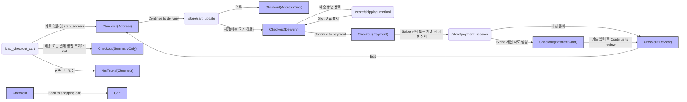

- `/checkout`은 쿠키가 없거나 카트 조회 결과가 null이면 체크아웃 레이아웃의 404를 보여 준다. 단계는 `step` 쿼리로 바뀌고 같은 페이지다.
- 주소를 저장하면 `/{배송 국가}/checkout?step=delivery`로 서버 이동한다(분석서 I07). 저장 오류는 폼 아래 메시지다.
- 배송 방법은 고르는 즉시 저장되고, 저장된 방법이 있어야 결제 단계로 넘어간다.
- 배송 또는 결제 방법 조회 결과가 `null`이면 입력 폼을 생략하고 요약만 그린다. 빈 배열은 폼 생략 조건에 해당하지 않는다. 결제 단계에서 Stripe 계열을 고르면 세션을 만든 뒤 같은 단계에서 카드 입력란을 보여 준다. 그 밖에는 검토 단계로 간다. 세션 오류는 결제 단계에 표시된다.
- 완료된 단계의 Edit은 해당 단계로 돌아간다(그림은 주소를 대표로 그렸다).

### 화면 확인 링크

| 페이지·장면 | 화면 HTML | Layout |
| --- | --- | --- |
| Checkout · 주소 오류·배송·결제·카드 입력·검토 | [주소 입력](details/screens/checkout.html#address) · [폼 조회 실패](details/screens/checkout.html#summary-only) · [주소 오류](details/screens/checkout.html#address-error) · [배송 방법](details/screens/checkout.html#delivery) · [결제 수단](details/screens/checkout.html#payment) · [Stripe 카드 입력](details/screens/checkout.html#payment-card) · [검토](details/screens/checkout.html#review) · [저장 주소 선택](details/screens/checkout.html#saved-address) · [매장 픽업](details/screens/checkout.html#pickup) · [프로모션 입력](details/screens/checkout.html#promotion) | [배치·장면](screen-layout.md#checkout) |
| NotFound · 체크아웃 그룹 404 | [기본](details/screens/not-found.html#default) · [체크아웃 그룹 404](details/screens/not-found.html#checkout) | [배치·장면](screen-layout.md#not-found) |
| Cart · 기본 | [기본](details/screens/cart.html#default) | [배치·장면](screen-layout.md#cart) |

## N07. 주문하기(결제 수단별)

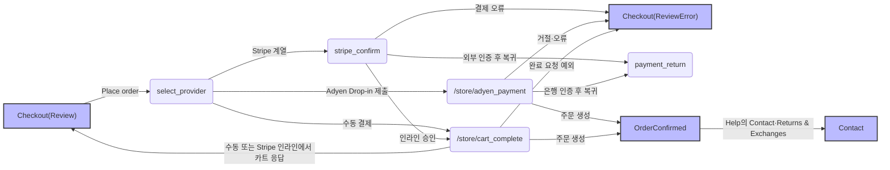

- 주문이 생기면 장바구니 쿠키를 지우고 `/{배송 국가}/order/{id}/confirmed`로 이동한다. 기본 시드는 수동 결제만 있다(분석서 I09).
- 요청 예외는 오류 메시지로 표시한다. 수동·Stripe 인라인 버튼은 `type: "cart"` 응답을 받으면 추가 안내 없이 검토 단계에 남을 수 있다. 외부 인증 복귀는 [N08](#n08)에서 이어진다.
- 주문 완료 페이지는 직접 열어도 주문을 조회해 보여 주고, 조회 실패면 404다. 로딩 중에는 스켈레톤이 보인다.

### 화면 확인 링크

| 페이지·장면 | 화면 HTML | Layout |
| --- | --- | --- |
| Checkout · 검토·주문 오류 | [검토](details/screens/checkout.html#review) · [주문 오류](details/screens/checkout.html#review-error) | [배치·장면](screen-layout.md#checkout) |
| OrderConfirmed · 로딩 | [기본](details/screens/order-confirmed.html#default) · [로딩](details/screens/order-confirmed.html#loading) | [배치·장면](screen-layout.md#order-confirmed) |
| Contact · 기본 | [기본](details/screens/contact.html#default) | [배치·장면](screen-layout.md#contact) |

## N08. 외부 결제 복귀

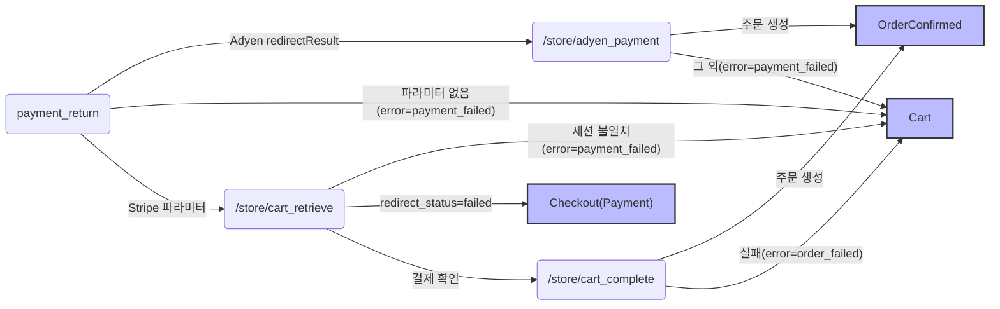

- 결제 제공자가 `/api/payment-return?cart_id=…&country_code=…`로 돌려보내면 Route Handler가 판단을 시작한다.
- 실패 복귀는 `Cart`에 `error` 쿼리를 붙이지만 장바구니 화면은 이를 표시하지 않아 기본 장면과 같다(분석서 I01).

### 화면 확인 링크

| 페이지·장면 | 화면 HTML | Layout |
| --- | --- | --- |
| OrderConfirmed · 기본 | [기본](details/screens/order-confirmed.html#default) | [배치·장면](screen-layout.md#order-confirmed) |
| Cart · 실패 복귀(기본과 같음) | [기본](details/screens/cart.html#default) | [배치·장면](screen-layout.md#cart) |
| Checkout · 결제 단계 | [결제 수단](details/screens/checkout.html#payment) | [배치·장면](screen-layout.md#checkout) |

## N09. 로그인과 회원가입

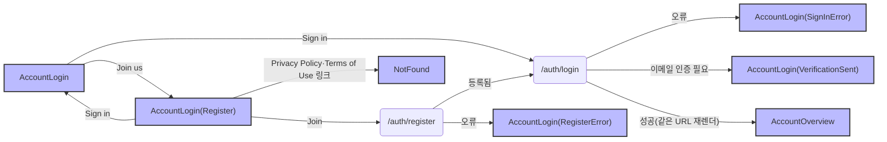

- 비로그인으로 `/account/**`를 열면 로그인 화면이 보인다. 로그인·회원가입은 같은 경로의 컴포넌트 전환이다.
- 로그인에 성공하면 같은 URL이 대시보드로 다시 그려진다. 하위 경로(예: `/account/orders`)에서 로그인했다면 그 페이지가 보인다.
- 이메일 인증이 필요하면 같은 화면에 "We sent a verification link" 안내가 뜬다. 인증은 [N10](#n10)에서 이어진다.
- 회원가입 동의 문구의 링크는 없는 경로라 404로 간다(분석서 I03).

### 화면 확인 링크

| 페이지·장면 | 화면 HTML | Layout |
| --- | --- | --- |
| AccountLogin · 로그인 오류·인증 메일 발송·회원가입·회원가입 오류 | [기본](details/screens/account-login.html#default) · [로그인 오류](details/screens/account-login.html#sign-in-error) · [인증 메일 발송](details/screens/account-login.html#verification-sent) · [회원가입](details/screens/account-login.html#register) · [회원가입 오류](details/screens/account-login.html#register-error) | [배치·장면](screen-layout.md#account-login) |
| AccountOverview · 기본 | [기본](details/screens/account-overview.html#default) | [배치·장면](screen-layout.md#account-overview) |
| NotFound · 기본 | [기본](details/screens/not-found.html#default) | [배치·장면](screen-layout.md#not-found) |

## N10. 이메일 인증

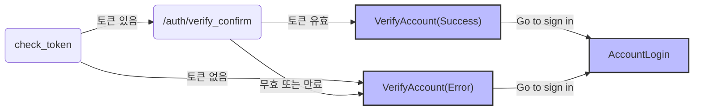

- 인증 메일 링크 `/{cc}/verify-account?token=`으로 들어오면 "Verifying your email..."을 보여 주며 확인 API를 호출한다. 직접 진입은 그림에 넣지 않았다.
- 두 결과 모두 Go to sign in을 누르면 로그인 화면으로 이동한다. 인증 후 첫 로그인에서 고객 레코드가 만들어진다.

### 화면 확인 링크

| 페이지·장면 | 화면 HTML | Layout |
| --- | --- | --- |
| VerifyAccount · 인증 성공·링크 무효 | [기본](details/screens/verify-account.html#default) · [인증 성공](details/screens/verify-account.html#success) · [링크 무효·만료](details/screens/verify-account.html#error) | [배치·장면](screen-layout.md#verify-account) |
| AccountLogin · 기본 | [기본](details/screens/account-login.html#default) | [배치·장면](screen-layout.md#account-login) |

## N11. 계정 영역 이동과 로그아웃

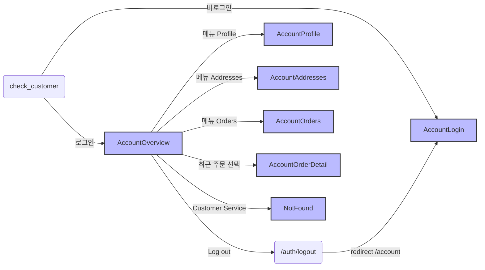

- `/account/**` 직접 진입·새로고침은 계정 레이아웃의 고객 조회에서 시작한다. 비로그인이면 어느 하위 경로든 로그인 화면을 보여 준다.
- 계정 메뉴는 모든 계정 페이지에 같은 모양으로 있다(그림은 개요를 대표로 그렸다). 개요는 프로필 완성도·주소 수·최근 주문을 보여 주고, 주문이 없으면 "No recent orders"다.
- Customer Service 링크는 없는 경로라 404로 간다(분석서 I03).
- 로그아웃은 토큰·장바구니 쿠키를 지우고 `/{cc}/account`로 이동한다.

### 화면 확인 링크

| 페이지·장면 | 화면 HTML | Layout |
| --- | --- | --- |
| AccountLogin · 기본 | [기본](details/screens/account-login.html#default) | [배치·장면](screen-layout.md#account-login) |
| AccountOverview · 주문 없음·로딩 | [기본](details/screens/account-overview.html#default) · [주문 없음](details/screens/account-overview.html#no-orders) · [로딩](details/screens/account-overview.html#loading) | [배치·장면](screen-layout.md#account-overview) |
| AccountProfile · 기본 | [기본](details/screens/account-profile.html#default) | [배치·장면](screen-layout.md#account-profile) |
| AccountAddresses · 기본 | [기본](details/screens/account-addresses.html#default) | [배치·장면](screen-layout.md#account-addresses) |
| AccountOrders · 기본 | [기본](details/screens/account-orders.html#default) | [배치·장면](screen-layout.md#account-orders) |
| AccountOrderDetail · 기본 | [기본](details/screens/account-order-detail.html#default) | [배치·장면](screen-layout.md#account-order-detail) |
| NotFound · 기본 | [기본](details/screens/not-found.html#default) | [배치·장면](screen-layout.md#not-found) |

## N12. 프로필 수정

화면 이동이 없는 과업이다. `AccountProfile`에서 이름·이메일·전화번호·청구지 주소 행마다 Edit을 눌러 펼치고 저장한다.

- 이름·전화번호·청구지의 저장 액션은 고객 또는 주소 API를 호출한다. 이메일 폼은 로컬 성공을 반환하고 원래 이메일을 계속 표시한다. 실패하면 펼친 행 아래에 오류 메시지가 보인다.
- 비밀번호 변경 행은 코드에서 주석 처리돼 화면에 없다(분석서 I11).

### 화면 확인 링크

| 페이지·장면 | 화면 HTML | Layout |
| --- | --- | --- |
| AccountProfile · 이름 편집·저장 오류 | [기본](details/screens/account-profile.html#default) · [이름 편집 열림](details/screens/account-profile.html#edit-name) · [저장 오류](details/screens/account-profile.html#edit-error) · [이메일 편집](details/screens/account-profile.html#edit-email) · [이메일 저장 결과](details/screens/account-profile.html#email-result) | [배치·장면](screen-layout.md#account-profile) |

## N13. 배송지 관리

화면 이동이 없는 과업이다. `AccountAddresses`에서 New address 카드로 추가 모달을, 주소 카드의 Edit으로 편집 모달을 연다.

- 저장하면 모달이 닫히고 목록이 갱신된다. 실패하면 모달 안에 오류를 보여 준다. Cancel은 모달만 닫는다.
- Remove는 바로 삭제를 요청한다. 삭제 액션이 실패를 호출자에게 전달하지 않으므로 오류 안내 없이 주소가 남을 수 있다. 저장한 주소는 체크아웃 주소 선택에 쓰인다.

### 화면 확인 링크

| 페이지·장면 | 화면 HTML | Layout |
| --- | --- | --- |
| AccountAddresses · 새 주소·주소 편집 모달 | [기본](details/screens/account-addresses.html#default) · [새 주소 모달](details/screens/account-addresses.html#add-modal) · [주소 편집 모달](details/screens/account-addresses.html#edit-modal) | [배치·장면](screen-layout.md#account-addresses) |

## N14. 주문 목록과 상세

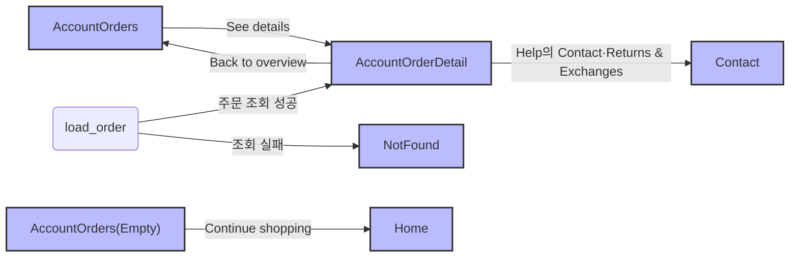

- 주문 목록은 카드마다 날짜·번호·금액·품목 미리보기와 See details를 보여 준다. 주문이 없으면 Continue shopping 버튼이 보인다.
- 상세 주소 직접 진입은 주문 조회(`load_order`)에서 시작한다. 백엔드가 조회를 거절하거나 주문 조회가 실패하면 404다. 페이지에서 별도로 고객 ID와 소유권을 대조하지 않는다.

### 화면 확인 링크

| 페이지·장면 | 화면 HTML | Layout |
| --- | --- | --- |
| AccountOrders · 주문 없음 | [기본](details/screens/account-orders.html#default) · [주문 없음](details/screens/account-orders.html#empty) | [배치·장면](screen-layout.md#account-orders) |
| AccountOrderDetail · 기본 | [기본](details/screens/account-order-detail.html#default) | [배치·장면](screen-layout.md#account-order-detail) |
| Home · 기본 | [기본](details/screens/home.html#default) | [배치·장면](screen-layout.md#home) |
| Contact · 기본 | [기본](details/screens/contact.html#default) | [배치·장면](screen-layout.md#contact) |
| NotFound · 기본 | [기본](details/screens/not-found.html#default) | [배치·장면](screen-layout.md#not-found) |

## N15. 주문 소유권 이전 요청

화면 이동이 없는 과업이다. `AccountOrders` 하단 "Order transfers" 폼에 주문 ID를 넣고 요청한다.

- 접수되면 입력 폼 아래에 닫을 수 있는 요청 완료 안내가 추가된다. ID가 비었거나 백엔드가 거절하면 오류 문구가 보인다.
- 원주문자에게 메일이 가는지는 백엔드 알림 설정에 달려 있다(미확인).

### 화면 확인 링크

| 페이지·장면 | 화면 HTML | Layout |
| --- | --- | --- |
| AccountOrders · 이전 요청 완료·오류 | [기본](details/screens/account-orders.html#default) · [이전 요청 완료](details/screens/account-orders.html#transfer-sent) · [이전 요청 오류](details/screens/account-orders.html#transfer-error) | [배치·장면](screen-layout.md#account-orders) |

## N16. 주문 소유권 이전 수락·거절

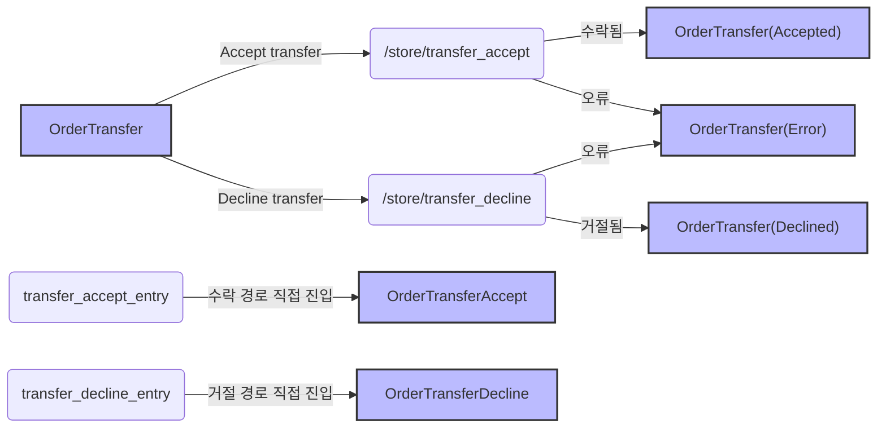

- 원주문자는 메일 링크 `/{cc}/order/{id}/transfer/{token}`으로 들어와 버튼으로 응답한다. 결과는 같은 페이지에 표시된다.
- `…/accept`, `…/decline`을 직접 열면 렌더링 중 바로 API를 호출하고 성공 또는 오류 문구만 보여 준다(분석서 I05). 두 페이지에는 공통 헤더·푸터 외 링크가 없다.

### 화면 확인 링크

| 페이지·장면 | 화면 HTML | Layout |
| --- | --- | --- |
| OrderTransfer · 수락·거절 완료·오류 | [기본](details/screens/order-transfer.html#default) · [수락 완료](details/screens/order-transfer.html#accepted) · [거절 완료](details/screens/order-transfer.html#declined) · [처리 오류](details/screens/order-transfer.html#error) | [배치·장면](screen-layout.md#order-transfer) |
| OrderTransferAccept · 오류 | [기본](details/screens/order-transfer-accept.html#default) · [오류](details/screens/order-transfer-accept.html#error) | [배치·장면](screen-layout.md#order-transfer-accept) |
| OrderTransferDecline · 오류 | [기본](details/screens/order-transfer-decline.html#default) · [오류](details/screens/order-transfer-decline.html#error) | [배치·장면](screen-layout.md#order-transfer-decline) |

## N17. 정책·안내 페이지

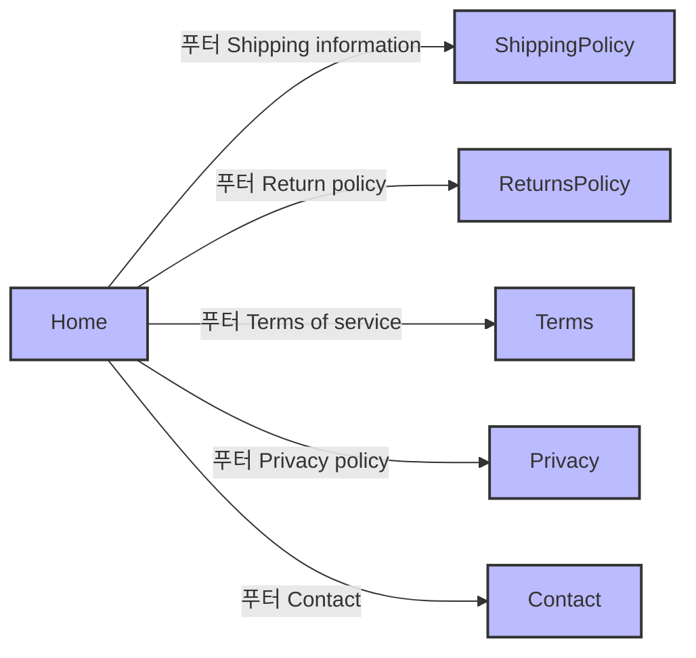

- 푸터는 모든 `(main)` 페이지에 있어 Home은 출발 페이지를 대표한다.
- 배송·반품 페이지는 현재 국가 지역의 정책 메타데이터를 읽고, 없으면 "Policy details for this region haven't been published yet."를 보여 준다. 약관·개인정보·문의는 placeholder 안내가 포함된 정적 페이지다.

### 화면 확인 링크

| 페이지·장면 | 화면 HTML | Layout |
| --- | --- | --- |
| Home · 기본 | [기본](details/screens/home.html#default) | [배치·장면](screen-layout.md#home) |
| ShippingPolicy · 정책 없음 | [기본](details/screens/shipping-policy.html#default) · [정책 없음](details/screens/shipping-policy.html#unavailable) | [배치·장면](screen-layout.md#shipping-policy) |
| ReturnsPolicy · 정책 없음 | [기본](details/screens/returns-policy.html#default) · [정책 없음](details/screens/returns-policy.html#unavailable) | [배치·장면](screen-layout.md#returns-policy) |
| Terms · 기본 | [기본](details/screens/terms.html#default) | [배치·장면](screen-layout.md#terms) |
| Privacy · 기본 | [기본](details/screens/privacy.html#default) | [배치·장면](screen-layout.md#privacy) |
| Contact · 기본 | [기본](details/screens/contact.html#default) | [배치·장면](screen-layout.md#contact) |

## N18. 퍼머링크와 에이전트 장바구니 이어받기

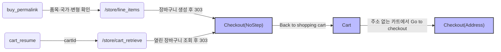

- `/buy/{variant}:{qty},...?context/address_country=` 링크나 UCP의 `continue_url`(`/{cc}/cart/resume/{cartId}`)로 들어오면 장바구니를 쿠키에 넣고 체크아웃으로 보낸다. 두 경로 모두 `step` 없이 이동한다. 주소·배송·결제·검토 컴포넌트는 각자의 `step` 값에서만 열리므로 처음에는 모두 접혀 있다. 신규 무주소 카트에는 주소 Edit도 없다. 상단 링크로 장바구니에 돌아가 Go to checkout을 누르면 필요한 단계가 열린다.
- 형식 오류·배송 불가 국가·없는 변형·구매 불가(400·404)와 완료·취소된 장바구니(410)는 화면이 아닌 평문 응답이다(분석서 I06).

### 화면 확인 링크

| 페이지·장면 | 화면 HTML | Layout |
| --- | --- | --- |
| Cart · 기본 | [기본](details/screens/cart.html#default) | [배치·장면](screen-layout.md#cart) |
| Checkout · 단계 미선택과 주소 입력 | [단계 미선택](details/screens/checkout.html#no-step) · [주소 입력](details/screens/checkout.html#address) | [배치·장면](screen-layout.md#checkout) |

## N19. 없는 페이지

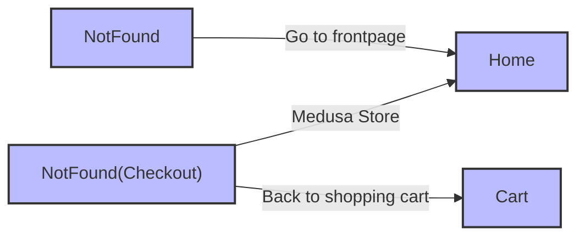

- 정의되지 않은 경로나 `notFound()`를 부른 페이지는 소속 그룹의 404를 보여 준다. `(main)`은 공통 헤더·푸터와 함께, 체크아웃 그룹은 체크아웃 헤더와 함께, 국가 세그먼트 밖은 셸 없이 보인다.

### 화면 확인 링크

| 페이지·장면 | 화면 HTML | Layout |
| --- | --- | --- |
| NotFound · 장바구니·체크아웃·루트 404 | [기본](details/screens/not-found.html#default) · [장바구니 페이지 예외](details/screens/not-found.html#cart) · [체크아웃 그룹 404](details/screens/not-found.html#checkout) · [루트 404](details/screens/not-found.html#root) | [배치·장면](screen-layout.md#not-found) |
| Home · 기본 | [기본](details/screens/home.html#default) | [배치·장면](screen-layout.md#home) |
| Cart · 기본 | [기본](details/screens/cart.html#default) | [배치·장면](screen-layout.md#cart) |
