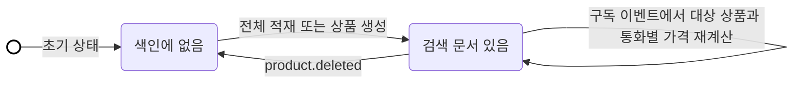
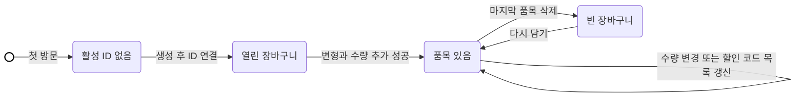
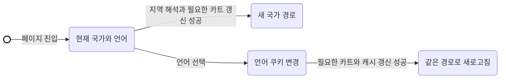
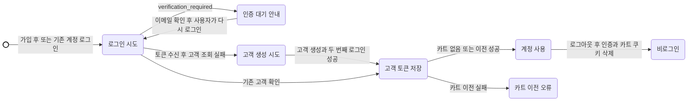
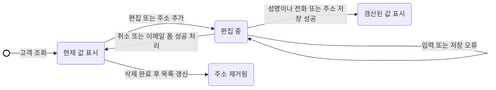
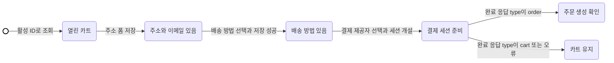
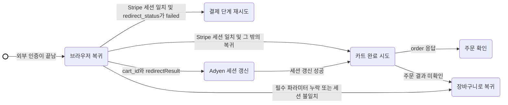
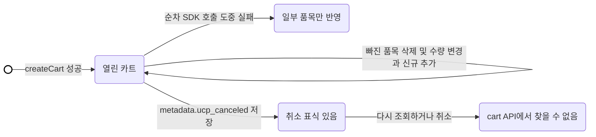
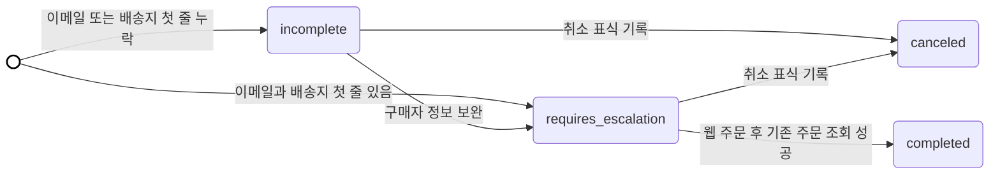
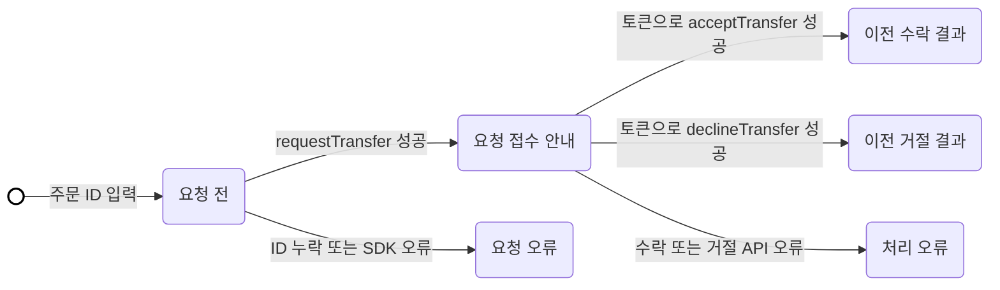

# 시나리오 기반 상태 전이 분석서

어떤 응답을 받으면 장바구니가 주문이 되는지, 인증된 신원이 언제 고객이 되는지, 에이전트가 읽는 상태와 화면이 어떻게 연결되는지를 추적한다. 도표에 쓰인 한국어 상태는 관찰 가능한 값의 조합이다. `incomplete` 같은 영문 값은 실제 응답 필드다.

| 업무 | 시나리오 |
| --- | --- |
| 상품·가격 | [상품 변경이 검색 색인에 반영된다](#st01) |
| 구매 준비 | [상품을 담고 활성 장바구니를 정한다](#st02) · [국가·언어를 변경한다](#st03) |
| 계정 | [인증 신원과 고객이 연결된다](#st04) · [고객이 프로필과 주소를 수정한다](#st05) |
| 체크아웃·주문 | [배송·결제 정보를 채워 주문한다](#st06) · [외부 인증에서 돌아온다](#st07) |
| 에이전트 구매 | [장바구니를 갱신하거나 취소한다](#st08) · [체크아웃 상태를 읽고 결제를 위임한다](#st09) |
| 사후 처리 | [주문 소유권 이전 요청을 처리한다](#st10) |

## 상품 변경이 검색 색인에 반영된다

Medusa 검색 모듈은 상품 ID를 키로 검색 문서를 관리한다. 상품 생성·수정은 다시 읽기를 유발하고, 변형이나 태그 변경은 연결된 상품을 찾아 다시 읽게 한다.

`PRODUCT_EVENTS`에는 상품·변형·옵션, 옵션 값·태그·카테고리의 일부 변경과 판매 채널 삭제가 있다. 가격표 시작·종료나 직접 가격 수정처럼 이벤트가 없는 경로에서는 검색 가격과 상품 상세 가격이 일시적으로 다를 수 있다. 동기화 지연 시간은 배포 환경에서 측정해야 한다. [이벤트와 변환](../../../../apps/backend/src/search/product.ts) · [대상 상품 해석](../../../../apps/backend/src/search/helpers/resolve-product-ids.ts)

## 상품을 담고 활성 장바구니를 정한다

구매자 브라우저는 활성 장바구니 ID를 쿠키로 기억하고, Medusa는 품목과 수량을 저장한다.

서버 액션은 ID가 없거나 기존 카트를 읽지 못하면 생성하고, 지역이 다르면 업데이트한 뒤 담는다. HTML 폼은 기존 ID로 담기가 실패하면 새 카트로 한 번 재시도하고 성공한 ID를 활성화한다. 빈 카트와 조회 실패가 화면에서 같아 보이는 경우도 있다. `retrieveCart`가 SDK 조회 실패에 `null`을 반환하면 `/cart`는 빈 화면을, `/checkout`은 404를 그린다. [장바구니 액션](../../../../apps/storefront/src/lib/data/cart.ts) · [JS·HTML 분기](navigation.md#n04)

## 국가나 언어를 바꾸면 판매·표시 문맥이 바뀐다

구매자가 국가를 고르면 스토어프런트는 해당 지역을 찾고 기존 카트가 있으면 지역 변경을 요청한다. 언어 선택은 지원 로케일이 제공될 때 표시된다.

국가 변경은 새 접두어와 현재 pathname으로 이동한다. 언어는 먼저 `_medusa_locale`을 기록하고 기존 카트의 `locale`을 바꾼다. 뒤의 요청이 실패하면 쿠키와 카트의 값이 달라질 수 있다. [국가 변경](../../../../apps/storefront/src/lib/data/cart.ts) · [언어 변경](../../../../apps/storefront/src/lib/data/locale-actions.ts)

## 이메일 인증과 첫 로그인으로 고객을 연결한다

스토어프런트는 가입 입력의 추가 필드를 임시 쿠키에 보관한다. 신원 등록·인증 및 고객 레코드의 쓰기 주체는 Medusa다.

인증 메일 요청 실패도 인증 대기 안내로 귀결된다. 인증 링크를 열어도 자동 로그인하지 않는다. `completeLogin`은 고객 조회 예외를 모두 고객 생성 시도로 연결한다. 토큰 저장이 카트 이전보다 앞서므로 이전 오류와 로그인 상태가 동시에 나타날 수 있다. 고객과 카트가 있고 `cart.customer_id`가 비어 있으면 배너에서 이전을 다시 요청할 수 있다. [로그인·로그아웃 액션](../../../../apps/storefront/src/lib/data/customer.ts) · [재시도 배너](../../../../apps/storefront/src/modules/layout/components/cart-mismatch-banner/index.tsx)

## 프로필과 배송지를 편집하면 항목별로 다른 결과가 남는다

회원은 같은 페이지에서 편집한다. Medusa 고객 서비스가 성명·전화·주소 데이터를 보유하고, 편집 열림·성공·오류 표시는 클라이언트 컴포넌트가 보유한다.

이메일 편집 함수는 로컬에서 성공을 반환하므로 저장 후에도 백엔드 이메일은 그대로다. 주소 삭제 액션은 SDK 실패를 내부에서 처리하고 호출자에게 오류 상태를 전달하지 않아 카드가 남을 수 있다. [이메일 폼](../../../../apps/storefront/src/modules/account/components/profile-email/index.tsx) · [주소 액션](../../../../apps/storefront/src/lib/data/customer.ts)

## 배송과 결제 정보를 채운 뒤 카트를 주문으로 완료한다

`step` 쿼리는 현재 열린 화면 영역이다. 서버에 저장되는 주소·배송 방법·결제 세션과 독립적이다. `Go to checkout`은 첫 미완료 항목을 보고 주소·배송·결제 중 하나를 연다.

검토 단계는 배송지·배송 방법과 결제 컬렉션 또는 전액 기프트카드 조건을 확인한다. 제출 버튼은 별도로 청구지·이메일 등도 확인한다. `placeOrder`는 주문 응답에서 캐시 무효화, 쿠키 삭제 호출, 주문 확인 페이지 이동을 수행한다. 카트 응답이면 카트를 반환한다. 인라인 수동·Stripe 버튼은 이 반환값에 전용 메시지를 표시하지 않는다. [단계 선택](../../../../apps/storefront/src/modules/cart/templates/summary.tsx) · [검토 가드](../../../../apps/storefront/src/modules/checkout/components/review/index.tsx) · [주문 완료](../../../../apps/storefront/src/lib/data/cart.ts)

## 외부 결제 인증에서 돌아오면 결제 세션을 확인한다

Stripe 계열과 Adyen은 복귀 경로를 공유한다. 판정 근거는 제공자별로 다르며, 실제 승인·정산 결과는 해당 환경의 제공자가 결정한다.

Stripe는 카트의 세션 데이터와 대조한 뒤 활성 ID를 복원한다. Adyen 인라인 처리에서는 `requires_more`와 `action`이 있으면 Drop-in에 추가 동작을 전달한다. 복귀 핸들러에서 주문 확인으로 이동하지 못하면 장바구니 오류 쿼리로 이동할 수 있으며, 장바구니 페이지는 해당 쿼리를 표시하지 않는다. [결제 복귀 핸들러](../../../../apps/storefront/src/app/api/payment-return/route.ts) · [Adyen 액션](../../../../apps/storefront/src/lib/data/adyen.ts)

## 에이전트가 품목 목록을 교체하거나 카트를 취소한다

UCP의 cart ID는 Medusa 카트 ID다. `PUT`은 원하는 전체 변형·수량 목록을 현재 목록과 비교한다.

Cart API는 취소·완료 카트를 열린 카트 조회에서 제외한다. 반면 체크아웃 API는 취소된 상태도 조회한다. 생성 시 제공된 멱등 키는 `cart`·`checkout` 범위별로 같은 프로세스 메모리에 최대 10분, 전체 최대 500개까지 보관된다. 캐시하는 값은 카트 생성 Promise다. 품목·구매자 정보 갱신 전체에 걸친 트랜잭션이나 인스턴스 간 중복 제거는 이 코드가 제공하는 보장이 아니다. [UCP 생성·수정·취소](../../../../apps/storefront/src/lib/ucp/operations.ts) · [카트 생성 순서](../../../../apps/storefront/src/lib/util/server-cart.ts)

## 에이전트가 상태를 조회하고 구매자에게 결제를 넘긴다

Next.js는 세션 조회 때마다 같은 카트에서 UCP 상태를 계산한다. `completeCheckout`도 이 읽기 경로를 사용한다.

판정 우선순위는 `ucp_canceled`, 확인된 주문, 필수 정보 누락, 구매자 결제 필요 순이다. `completed_at`이 있어도 기존 주문 조회가 실패하면 나머지 필드로 상태를 계산한다. 열린 상태의 `continue_url`은 브라우저에서 카트를 확인하고 쿠키를 연결한 뒤 `step` 없는 체크아웃으로 이동한다. 재개 시 이미 완료·취소됐거나 카트를 읽을 수 없으면 410이다. 이미 완료된 체크아웃의 취소 요청은 409, 취소된 체크아웃의 반복 취소는 취소 상태를 돌려준다. [상태 계산](../../../../apps/storefront/src/lib/ucp/operations.ts) · [웹 인계 결과](navigation.md#n18)

## 주문 소유권 이전을 요청하고 수락 또는 거절한다

고객이 주문 ID를 제출하면 스토어프런트가 이전 요청을 Medusa에 전달한다. 접수 성공은 소유권 변경과 별개의 결과다.

확인 페이지 버튼은 같은 페이지에서 결과를 보여 준다. 직접 `/accept`·`/decline` 경로로 진입하면 각 서버 페이지의 렌더 중 해당 작업을 호출한다. 메일 발송은 화면 문구만으로 확인할 수 없고, 토큰 만료 시간이나 중복 처리 정책은 저장소에 구현돼 있지 않다. [주문 액션](../../../../apps/storefront/src/lib/data/orders.ts) · [버튼별 결과](../../../../apps/storefront/src/modules/order/components/transfer-actions/index.tsx)
