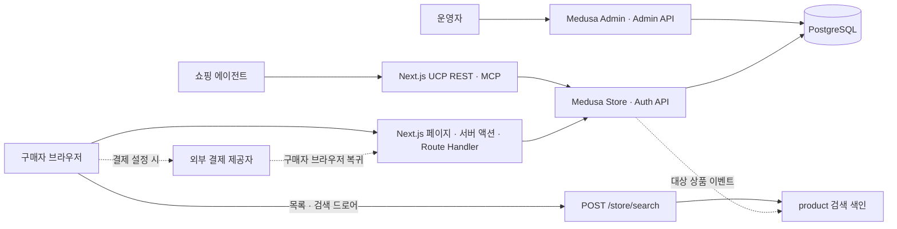

# Medusa DTC Starter AS-IS 설계 분석

**기준일 2026년 11월 22일 · `main@0b24157` · 분석 대상은 저장소의 백엔드와 스토어프런트다.**

구매자가 상품을 담고 결제하면 Next.js가 브라우저의 장바구니 ID로 Medusa에 완료를 요청한다. 주문 생성의 기준은 Medusa의 `type: "order"` 응답이다. 에이전트도 같은 장바구니를 만들고 수정할 수 있다. UCP 체크아웃은 구매자에게 결제 링크를 넘기며, 주문 여부는 이후 같은 장바구니에서 조회한다.

| 알고 싶은 사항 | 문서 |
| --- | --- |
| 화면과 예외 경로를 따라가려면 | [19개 화면 이동 시나리오](navigation.md) · [25개 화면의 배치와 HTML](screen-layout.md) |
| 어느 시점에 어떤 데이터가 바뀌는지 보려면 | [시나리오 기반 상태 전이 분석서](scenario-state-analysis.md) |
| 사람·에이전트와 서비스 사이의 계약을 보려면 | [시스템 외부에서 본 흐름](details/job-flow/macro.md) · [두 서비스 사이의 호출](details/job-flow/system.md) |
| 구현을 따라가려면 | [스토어프런트 내부 흐름](details/job-flow/storefront.md) · [백엔드 내부 흐름](details/job-flow/backend.md) |

## 1. 범위와 기준선

- 앱 소스, 설정, 초기 데이터 스크립트, 라우트와 폼 처리 함수를 대조했다. `page.tsx` 24개에 계정 로그인·대시보드 슬롯이 포함된다. 루트·메인·장바구니·체크아웃의 `not-found.tsx` 4개는 안내 화면 1개의 장면으로 묶었다. `route.ts` 17개는 화면을 반환하는 페이지 집계에서 제외하고 API·리다이렉트·문서 출력으로 조사했다. [라우트 트리](../../../../apps/storefront/src/app)
- 이전 분석의 기준 커밋 `44f2979`와 이번 기준선 사이에서 `apps/`의 소스 차이는 없었다. 기존 자료의 화면 ID와 시나리오를 이어 쓰고, 현재 핸들러에 맞춰 오류 분기와 직접 진입 결과를 수정했다. 작업 시작 시 이전 분석 디렉터리는 삭제 상태였다.
- Medusa Admin은 패키지 제공 화면이다. 프로젝트에는 번역 등록 틀만 있으며 자체 관리자 페이지·위젯은 없다. Admin 접근과 데이터 관리 경계까지 분석했다. 환경별 운영 데이터, 패키지 내부의 트랜잭션 순서, 외부 결제 승인과 메일 수신 여부는 확인 범위 밖이다. [관리자 확장 코드](../../../../apps/backend/src/admin) · [백엔드 구성](../../../../apps/backend/medusa-config.ts)

## 2. 시스템 구조와 데이터 소유권

| 상태·용어 | 소유자와 소비 방식 |
| --- | --- |
| 판매 지역 (`region`)과 판매 채널 | 국가는 지역의 통화·배송 범위에 연결된다. 공개 API 키가 판매 채널 범위를 정한다. 색인은 `status`와 `sales_channel_ids`를 필터 전용으로 둔다. [국가 라우팅](../../../../apps/storefront/src/middleware.ts) · [검색 미들웨어](../../../../apps/backend/src/api/middlewares.ts) |
| 상품·변형 (`variant`)과 검색 문서 | 구매 단위는 변형 ID다. 상품·옵션·가격의 원본은 Medusa가 관리한다. 색인은 상품 ID별 파생 문서에 옵션과 EUR/USD 가격을 저장한다. [색인 정의](../../../../apps/backend/src/search/product.ts) · [가격 계산](../../../../apps/backend/src/search/helpers/pricing.ts) |
| 장바구니·결제 세션·주문 | Medusa가 품목, 주소, 배송 방법, 할인·결제 정보를 보유한다. Next.js가 세션 준비와 완료를 요청하고 결과에 따라 화면을 바꾼다. [장바구니 액션](../../../../apps/storefront/src/lib/data/cart.ts) |
| 인증 신원과 고객 레코드 | 이메일 인증 신원 생성과 고객 레코드 생성 시점이 다르다. 로그인 결과와 `customers/me` 조회에 따라 고객을 생성하고 토큰을 다시 받는다. [고객 액션](../../../../apps/storefront/src/lib/data/customer.ts) |
| 쿠키와 캐시 | `_medusa_cart_id`와 `_medusa_jwt`는 7일 HTTP-only 쿠키다. 가입 폼의 추가 정보는 `_medusa_pending_customer`에 최대 하루 보관한다. `_medusa_cache_id`는 방문자별 조회 캐시 태그의 접미사다. 언어는 별도의 `_medusa_locale`에 저장한다. [쿠키](../../../../apps/storefront/src/lib/data/cookies.ts) · [언어 변경](../../../../apps/storefront/src/lib/data/locale-actions.ts) |
| UCP 체크아웃 세션 | 세션 ID는 Medusa 장바구니 ID다. API 상태는 취소 표식·주문 확인·필수 필드로 계산한다. REST와 MCP가 같은 연산을 사용한다. [UCP 연산](../../../../apps/storefront/src/lib/ucp/operations.ts) · [MCP 처리](../../../../apps/storefront/src/lib/ucp/mcp.ts) |

## 3. 실행 구성과 초기 데이터

| 항목 | 저장소에서 확인한 구성 |
| --- | --- |
| 워크스페이스 | `pnpm@10.11.1`, 루트·백엔드의 Node.js 엔진 `>=22.23.4`. 루트 `dev`·`build`는 pnpm 재귀 실행이고, 앱별 개발·lint·start 등은 Turbo 작업을 사용한다. README의 DB 전제는 PostgreSQL 15 이상이다. [루트 매니페스트](../../../../package.json) · [작업 그래프](../../../../turbo.json) · [설치 안내](../../../../README.md) |
| 커머스 서버 | Medusa `2.22.7`. 개발 기본 포트 9000, Admin은 `/app`. `DATABASE_URL`, Store/Admin/Auth CORS와 서명용 설정을 환경에서 읽는다. 프로젝트의 `GET /store/custom`, `GET /admin/custom`는 각각 200만 반환한다. [백엔드 매니페스트](../../../../apps/backend/package.json) · [설정](../../../../apps/backend/medusa-config.ts) · [예시 라우트](../../../../apps/backend/src/api) |
| 구매 화면 | Next.js `16.3.8`, React `19.0.5`, 포트 8000. Next 설정을 읽을 때 `NEXT_PUBLIC_MEDUSA_PUBLISHABLE_KEY`를 검사한다. SDK에는 로컬 백엔드 주소 기본값이 있지만 지역 미들웨어는 `NEXT_PUBLIC_MEDUSA_BACKEND_URL`이 필요하다. [매니페스트](../../../../apps/storefront/package.json) · [SDK 설정](../../../../apps/storefront/src/lib/config.ts) · [환경 검사](../../../../apps/storefront/check-env-variables.js) |
| 초기 마이그레이션 | 판매 채널·공개 키·스토어, EUR 지역인 Europe과 7개국, 세금 지역, 재고 위치, 배송 설정, 상품 4종과 재고를 만든다. 스토어 지원 통화는 EUR/USD, 시드 지역의 결제 제공자는 `pp_system_default`다. [초기 시드](../../../../apps/backend/src/migration-scripts/initial-data-seed.ts) |
| 정책과 데모 카탈로그 | 별도 마이그레이션이 기존 지역의 누락된 정책 키를 채운다. 배송·반품 화면과 구조화 데이터가 지역 메타데이터를 읽는다. 선택 실행하는 데모 스크립트는 고정 핸들로 최대 50개 상품을 추가한다. [정책 마이그레이션](../../../../apps/backend/src/migration-scripts/region-store-policies.ts) · [데모 스크립트](../../../../apps/backend/src/scripts/seed-demo-products.ts) |
| 검증 수단 | 백엔드에 Jest 단위·모듈·HTTP 통합 실행 스크립트와 준비 파일이 있다. 기준 커밋에서 해당 테스트 명명 규칙에 맞는 테스트 파일은 0개다. 스토어프런트에는 테스트 스크립트가 없다. [Jest 설정](../../../../apps/backend/jest.config.js) |

## 4. 주요 계약

**국가별 상품 탐색.** `/`는 기본 국가의 홈으로 내부 rewrite한다. 국가 없는 다른 사용자 경로는 국가 접두어를 붙여 307로 이동한다. 전체 상품 목록과 헤더 드로어는 `POST /store/search`로 상품 색인을 조회한다. 독립 검색 페이지와 UCP 카탈로그 검색은 지역별 상품 목록을 조회한다. 검색창을 열었던 위치에 따라 결과 수, 필터, 색인 반영 시점이 달라질 수 있다. [검색 클라이언트](../../../../apps/storefront/src/lib/search-client.ts) · [화면별 검색 흐름](navigation.md#n03) · [UCP 카탈로그](../../../../apps/storefront/src/lib/ucp/operations.ts)

**장바구니에서 주문까지.** JS 상품 담기는 서버 액션으로 장바구니를 생성하거나 기존 지역을 갱신한다. JS 없는 폼은 쿠키 ID에 담기를 시도한 뒤 실패하면 새 장바구니로 한 번 재시도한다. 체크아웃에서 주소·배송·결제 세션을 채우고 완료 응답을 확인한다. `type: "cart"`가 돌아오면 주문 화면으로 이동하지 않는다. 기본 시드에서는 수동 결제 경로가 해당된다. Stripe·Adyen의 위젯과 복귀 핸들러는 제공자가 구성된 환경에서 사용하는 코드다. [담기 비교](navigation.md#n04) · [결제 복귀](../../../../apps/storefront/src/app/api/payment-return/route.ts)

**에이전트 구매.** `/.well-known/ucp`가 구현 버전 `2026-08-25`와 REST·MCP 주소를 알린다. `GET /ucp/v1`은 작업 목록을, `POST /ucp/mcp`는 JSON-RPC를 제공한다. 카탈로그 검색·조회, 장바구니 생성·수정·취소, 체크아웃 세션을 지원한다. 금액은 UCP 응답에서 통화의 최소 단위로 변환한다. `complete`는 현재 상태를 읽으며, 열려 있는 세션의 `continue_url`이 구매자를 웹 체크아웃으로 보낸다. 상품 Markdown, `llms.txt`, 사이트맵과 JSON-LD도 같은 판매 데이터를 노출한다. [작업 목록](../../../../apps/storefront/src/app/ucp/v1/route.ts) · [변환 규칙](../../../../apps/storefront/src/lib/ucp/ucp.ts) · [상품 Markdown 라우팅](../../../../apps/storefront/next.config.js)

## 5. 기능 목록

| ID | 기능 | 실제 진입점 | 관련 문서 |
| --- | --- | --- | --- |
| F01 | 국가 코드 라우팅·국가 변경 | `middleware.ts`, 사이드 메뉴 `CountrySelect` → `updateRegion` | [N01](navigation.md#n01) · [상태 전이](scenario-state-analysis.md#st03) |
| F02 | 홈·컬렉션 레일 | `/{cc}` | [N02](navigation.md#n02) |
| F03 | 전체 상품 목록·필터·검색(InstantSearch) | `/{cc}/store`, `POST /store/search` | [N02](navigation.md#n02), [N03](navigation.md#n03) · [상태 전이](scenario-state-analysis.md#st01) |
| F04 | 카테고리·컬렉션 목록 | `/{cc}/categories/[...]`, `/{cc}/collections/[handle]` | [N02](navigation.md#n02) |
| F05 | 헤더 검색 드로어·검색 페이지 | 헤더 검색 아이콘, `/{cc}/search?q=` | [N03](navigation.md#n03) |
| F06 | 상품 상세·옵션 선택 | `/{cc}/products/[handle]` | [N04](navigation.md#n04) |
| F07 | 장바구니 담기(JS·폼) | `addToCart` Server Action, `POST /{cc}/cart/add` | [N04](navigation.md#n04) · [상태 전이](scenario-state-analysis.md#st02) |
| F08 | 장바구니 수량 변경·삭제·할인 코드 | `/{cc}/cart`, `updateLineItem`, `deleteLineItem`, `applyPromotions` | [N05](navigation.md#n05) |
| F09 | 체크아웃 주소·배송·결제 단계 | `/{cc}/checkout?step=` | [N06](navigation.md#n06) · [상태 전이](scenario-state-analysis.md#st06) |
| F10 | 주문하기(수동·Stripe 계열·Adyen) | 검토 단계 Place order, `placeOrder` | [N07](navigation.md#n07) · [상태 전이](scenario-state-analysis.md#st06) |
| F11 | 외부 결제 복귀 | `GET /api/payment-return` | [N08](navigation.md#n08) · [상태 전이](scenario-state-analysis.md#st07) |
| F12 | 주문 완료 화면 | `/{cc}/order/[id]/confirmed` | [N07](navigation.md#n07) |
| F13 | 로그인·회원가입 | `/{cc}/account`(비로그인) | [N09](navigation.md#n09) · [상태 전이](scenario-state-analysis.md#st04) |
| F14 | 이메일 인증 | `/{cc}/verify-account?token=` | [N10](navigation.md#n10) · [상태 전이](scenario-state-analysis.md#st04) |
| F15 | 계정 개요·로그아웃 | `/{cc}/account`(로그인) | [N11](navigation.md#n11) |
| F16 | 프로필 수정 | `/{cc}/account/profile` | [N12](navigation.md#n12) · [상태 전이](scenario-state-analysis.md#st05) |
| F17 | 배송지 관리 | `/{cc}/account/addresses` | [N13](navigation.md#n13) · [상태 전이](scenario-state-analysis.md#st05) |
| F18 | 주문 목록·상세 | `/{cc}/account/orders`, `/{cc}/account/orders/details/[id]` | [N14](navigation.md#n14) |
| F19 | 주문 소유권 이전 요청 | `Orders` 하단 폼 | [N15](navigation.md#n15) · [상태 전이](scenario-state-analysis.md#st10) |
| F20 | 주문 소유권 이전 수락·거절 | `/{cc}/order/[id]/transfer/[token]`, `/accept`, `/decline` | [N16](navigation.md#n16) · [상태 전이](scenario-state-analysis.md#st10) |
| F21 | 정책·안내 페이지 | `/{cc}/shipping`, `returns`, `terms`, `privacy`, `contact` | [N17](navigation.md#n17) |
| F22 | 퍼머링크·에이전트 장바구니 이어받기 | `GET /buy/[items]`, `GET /{cc}/cart/resume/[cartId]` | [N18](navigation.md#n18) · [상태 전이](scenario-state-analysis.md#st09) |
| F23 | 없는 페이지 | `not-found.tsx` 4곳 | [N19](navigation.md#n19) |
| F24 | UCP 카탈로그·장바구니·체크아웃 API | `/ucp/v1/**`, `/ucp/mcp`, `/.well-known/ucp` | [macro.md](details/job-flow/macro.md#m04-ai-에이전트의-장바구니-위임), [storefront.md](details/job-flow/storefront.md#s06-ucp-체크아웃-세션) · [상태 전이](scenario-state-analysis.md#st08) |
| F25 | 에이전트·검색엔진용 출력 | `llms.txt`, `robots.ts`, `sitemap.ts`, 상품 Markdown, JSON-LD | [상품 Markdown 라우팅](../../../../apps/storefront/next.config.js) · [발견 문서](../../../../apps/storefront/src/app/llms.txt/route.ts) |
| F26 | 상품 검색 색인 갱신 | 상품·변형·옵션 등 16개 이벤트 구독(`PRODUCT_EVENTS`) | [backend.md](details/job-flow/backend.md#b03-상품-검색-색인-갱신) · [상태 전이](scenario-state-analysis.md#st01) |
| F27 | 초기 데이터·데모 상품 시드 | `db:migrate`의 migration-scripts, `seed-demo-products.ts` | [backend.md](details/job-flow/backend.md#b04-초기-데이터-시드) |
| F28 | 운영자 관리(상품·주문·지역 등) | Medusa Admin `/app` | 화면 제외. [macro.md](details/job-flow/macro.md) 외부 객체로만 표시 |

## 6. 화면과 데이터가 달라지는 조건

| ID | 내용 | 근거 | 영향 |
| --- | --- | --- | --- |
| I01 | 결제·주문 실패 복귀 시 `Cart?error=payment_failed\|order_failed`로 보내지만 장바구니 페이지가 `error`를 읽지 않는다 | `api/payment-return/route.ts`, `(main)/cart/page.tsx` | 구매자가 실패 이유를 모른다 |
| I02 | 장바구니의 Sign in으로 로그인해도 장바구니·체크아웃으로 돌아가지 않는다 | `modules/cart/components/sign-in-prompt`, `account/layout.tsx` | 구매 흐름이 끊긴다 |
| I03 | 회원가입의 `/content/privacy-policy`, `/content/terms-of-use`, 계정 레이아웃의 `/customer-service`가 없는 경로다 | `components/register`, `templates/account-layout.tsx` | 404 표시 |
| I04 | JS 상품 담기가 예외를 잡지 않아 실패 시 로딩이 풀리지 않는다 | `product-actions/index.tsx` `handleAddToCart` | 안내 없이 버튼이 멈춘다 |
| I05 | 주문 이전 `accept`·`decline` 페이지가 GET 렌더링 중 상태를 바꾼다 | `transfer/[token]/accept/page.tsx`, `decline/page.tsx` | 결과 페이지를 여는 것 자체가 API 호출을 유발한다 |
| I06 | `/cart/add`, `/buy`, `/cart/resume` 실패가 평문 응답이다 | 각 `route.ts` | 복귀 링크가 없다 |
| I07 | 주소 저장 후 redirect가 배송지 국가 코드를 경로로 쓴다 | `lib/data/cart.ts` `setAddresses` | 경로 국가가 바뀔 수 있다 |
| I08 | 온보딩 CTA가 `http://localhost:7001`로 고정돼 있다 | `lib/data/onboarding.ts`, `product-onboarding-cta` | 온보딩 쿠키가 있을 때만 노출 |
| I09 | 외부 결제 모듈의 별도 등록이 없고 시드 지역은 수동 제공자만 연결한다 | `medusa-config.ts`, 시드 `payment_providers` | 운영 설정에 의존 |
| I10 | 검색 색인이 가격 목록·판매 채널 연결 등 일부 변경 이벤트를 받지 못한다(코드의 TODO) | `backend/src/search/product.ts` | 검색 결과의 가격·노출이 늦게 반영될 수 있다 |
| I11 | 프로필 비밀번호 변경 컴포넌트가 주석 처리돼 있다 | `@dashboard/profile/page.tsx` | 비밀번호 변경·재설정 화면이 없다 |
| I12 | `/buy`·`/cart/resume`은 `step` 없는 체크아웃으로 보낸다. 신규 무주소 카트는 주소 입력란이 자동으로 열리지 않는다 | [N18](navigation.md#n18) | 장바구니의 Go to checkout으로 다시 진입하면 주소 단계가 열린다 |
| I13 | 프로필 이메일 폼은 로컬 성공만 반환한다 | [이메일 컴포넌트](../../../../apps/storefront/src/modules/account/components/profile-email/index.tsx) | 기존 이메일이 유지된다 |
| I14 | 배송·결제 방법 조회 중 하나가 `null`이면 CheckoutForm이 빈 결과를 반환한다 | [체크아웃 폼](../../../../apps/storefront/src/modules/checkout/templates/checkout-form/index.tsx) | 주문 요약만 남는다 |

## 7. 검증 범위

| 확인 대상 | 이번 분석 결과 |
| --- | --- |
| 소스와 화면 대응 | 페이지 파일 24개와 404 경계 4곳을 화면 ID 25개에 대응시켰다. 25개 ID가 화면 목록·배치 절·HTML에서 일치한다. 화면 이동 시나리오 19개에는 각 장면을 여는 링크가 있다. [화면 목록](screen-layout.md#전체-페이지장면-목록) |
| 코드 교차 검토 | 독립 검토에서 카트 조회 실패, 퍼머링크의 단계 미선택, 이메일 폼의 로컬 성공, 검색 이벤트 범위를 원본과 비교해 정정했다. 로그인·카트·주문·UCP 등 상태 시나리오 10개의 분기를 대조했다. [상태 전이](scenario-state-analysis.md) |
| HTML 검증 | 초기 검토에서 모바일 로딩 화면과 주문 이전 화면의 가로 넘침을 발견해 수정했다. 최종본의 25개 HTML·90개 장면을 Chrome에서 390px·1280px로 열었다. 180회 확인에서 장면 선택 오류, 자바스크립트 예외, 가로 넘침이 없었다. 상품 담기 → 드롭다운 → 장바구니 → 주소 단계, 단계 미선택 체크아웃 → 장바구니의 링크도 직접 눌러 확인했다. [상품 상세](details/screens/product-detail.html#default) · [단계 미선택 체크아웃](details/screens/checkout.html#no-step) |
| 문서와 도표 검증 | Markdown 문서 8개의 상대 경로·앵커를 검사했다. HTML의 링크·자산 참조 608개와 장면 ID를 대조했다. 시스템 구성·화면 이동·상태 전이 Mermaid 29개와 업무 흐름 SVG 24개를 로컬 브라우저에서 렌더링했다. 화면 배치 DSL 27개는 텍스트와 대응 HTML을 대조했다. |

로컬 HTML은 예시 데이터를 사용한다. 앱 의존성이 설치되지 않은 작업 트리에서 저장소 소스를 분석했으며, 실제 앱·PostgreSQL·결제 제공자·메일 서비스와 연결한 통합 검증은 수행하지 않았다. 따라서 화면 재현 검증에서 실거래 승인, 메일 도달, 운영 데이터나 권한 정책의 검증 결과를 도출할 수 없다.

이 환경에는 Medusa 개발 스킬과 공식 문서 MCP가 연결되어 있지 않았다. 이후 패키지 내부 계약까지 확인할 때는 설치 버전의 패키지별 `AGENTS.md`와 공식 스킬·문서 MCP를 함께 사용할 수 있다. [프로젝트의 연결 안내](../../../../README.md)
